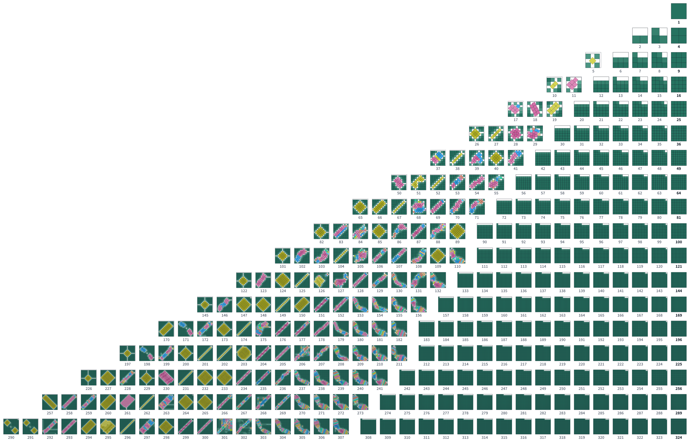

# The Squares Project

**[The Squares Project website](https://jlevy.github.io/squares/) is a full archive of
every known result on the square packing problem**, including the many new results since
August 2026, several of them first found here and since built on by many others.
Its atlas lists the best known packing and the current upper and lower bounds for every
case $n = 1\ldots324$, each with its source and credit.
It also includes documentation, papers, tools, and agent-based third-party validation
that rates how far each new result has been verified.
Its homepage links every other major resource on square packing.
All of it is generated from the record in this repository.

**On the website:** [Atlas](https://jlevy.github.io/squares/atlas.html) ·
[Results](https://jlevy.github.io/squares/results.html) ·
[Frontier Survey](https://jlevy.github.io/squares/atlas.html#the-frontier-survey) ·
[Papers](https://jlevy.github.io/squares/papers.html) ·
[Visualize](https://jlevy.github.io/squares/visualize.html) ·
[About](https://jlevy.github.io/squares/about.html)

[](https://jlevy.github.io/squares/)

> [!IMPORTANT]
> **Report your results!** If you have new results of any kind for square packing (a
> better packing, a lower bound, an exact value, a proof, a verification, or a
> correction), or know of newer results, please
> [file an issue](https://github.com/jlevy/squares/issues/new?template=result-registration.md)
> to report them, including the name you would like credited.
> We encourage real names, for better record keeping.
> Agents will validate, tabulate, and cite your work once it is a confirmed record.
>
> **[Report a Result →](https://github.com/jlevy/squares/issues/new?template=result-registration.md)**

## The Problem

<!-- BEGIN SHARED: project-intro (devtools.site_documents) -->

The square packing problem is a simple and long-standing problem in geometry: what is
the size of the smallest square that can hold $n$ unit squares, where the squares are
free to rotate but cannot overlap?
The side length of that smallest square is written $s(n)$.

The value of $s(n)$ remains unknown for most $n$. In many cases, $s(n)$ is known only to
lie between an upper bound (the size of the enclosing square for the tightest packing
ever discovered, such as $s(29) \le 5.934$) and a lower bound (a size below which it is
proved that no packing can exist, such as the reported $s(29) \ge 5.81$).

<!-- END SHARED: project-intro -->

## Recent Results

The website lists the [recent results](https://jlevy.github.io/squares/#recent-results)
and [every result](https://jlevy.github.io/squares/results.html), this project’s and
others’, each with its credit and
[verification rating](https://jlevy.github.io/squares/results.html#verification-ladders).
The most significant since August 2026:

- **Eleven squares settled:** $s(11) = 3.877083590022814\ldots$, the side of Walter
  Trump’s 1979 packing ([T-011](packing/frontier/RESULTS.md)), by Mannaseh Ahmed’s
  Astra-assisted proof
  [11SquaresOptimal](https://github.com/Queuingtheorydotcom/11SquaresOptimal), building
  on this project and Marc Leonard Overbeck (Kleddamag)
  ([T-060](packing/frontier/RESULTS.md)). This repository replayed the proof’s exact
  inputs and audited their composition.
  Trump’s packing is the only optimal one up to symmetry
  ([T-112](packing/frontier/RESULTS.md)). A Lean 4 formalization,
  [11SquaresFormalized](https://github.com/Queuingtheorydotcom/11SquaresFormalized), was
  announced on 6 October 2026 and is recorded as its source’s report.
  The [case record](packing/frontier/n-011.md) and
  [review](docs/project/reviews/review-2026-09-29-n11-optimality.md) state what the
  confirmation depends on.
- **An infinite family of exact values:** Evan Daniel proved $s(k^2 - 3) = k$ for every
  $k \ge 6$ ([T-064](packing/frontier/RESULTS.md)), and the exact values $s(21) = 5$,
  $s(32) = 6$, $s(45) = 7$ and $s(60) = 8$
  ([T-052, T-051, T-053 and T-062](packing/frontier/RESULTS.md)), independently of this
  project. His $s(k^2 - 4) = k$ for every $k \ge 5$
  ([T-081](packing/frontier/RESULTS.md)) awaits its full replay here, so its nine new
  cases, $n = 96, 117, \ldots, 320$, are on the frontier as reported bounds.
- **Seventeen squares reported proved:** on 12 October 2026 two proofs were published,
  by separate routes, that John Bidwell’s 1998 packing is optimal, so that
  $s(17) = 4.67553009360455\ldots$. Marc Leonard Overbeck (Kleddamag) published what he
  calls a candidate proof, one that holds if the 210 obligations it lists hold
  ([T-153](packing/frontier/RESULTS.md),
  [#557](https://github.com/jlevy/squares/issues/557)); its README says the mathematics,
  engines, certificates, checkers, reviews and text were produced by AI systems under
  his direction, Codex (OpenAI) and Claude (Anthropic).
  Oscar Fitzharding (ofitzharding) published a Lean 4 proof that leaves no premise open
  within its stated trust boundary ([T-154](packing/frontier/RESULTS.md),
  [#565](https://github.com/jlevy/squares/issues/565)); its README says the project “was
  developed with substantial assistance from Claude and Codex”.
  Reviews here read parts of both and found no mathematical defect in what they read,
  but neither has been replayed in full: parts of T-153’s computation have been rerun
  here, and T-154’s Lean build has not been repeated.
  So the record holds both as reported (`V0/C1`), and until a replay passes, the
  [case record](packing/frontier/n-017.md) keeps the verified bracket: Guzhou0806’s
  lower bound $s(17) > 4.66044275$ ([T-093](packing/frontier/RESULTS.md)) and the upper
  bound of Bidwell’s packing, certified exactly from Overbeck’s rational witness
  ([T-065](packing/frontier/RESULTS.md)).

## Papers

The website’s [papers page](https://jlevy.github.io/squares/papers.html) links each
paper and its PDF. Three form a series on $n = 11$:

1. [**New Lower Bounds for Square Packing for n = 11**](https://jlevy.github.io/squares/papers/n11-lower-bounds-explainer.html):
   weighted points and 2-of-3 threshold atoms prove $s(11) \ge 3.8264\ldots$.
2. [**A Review of the Certified Lower Bound s(11) > 31/8 for 11 Squares**](https://jlevy.github.io/squares/papers/n11-threshold-bound-review.html):
   Overbeck’s proof by k-of-m charges and a certificate over 12,028 angle rows.
3. [**A Review of the Optimality Proof of the Trump Packing of 11 Squares**](https://jlevy.github.io/squares/papers/n11-optimality-review.html):
   Ahmed’s proof that Trump’s packing is optimal.

[**How Record Square Packings Are Found**](https://jlevy.github.io/squares/papers/square-packing-methods-survey.html)
is a tutorial on geometric construction, physics-inspired search, annealing, surgery,
local refinement, and upper-bound certification.

The website is at edition `v0.6.1` and the atlas posters at `v0.6.0`; each paper carries
its own version.

## Repository Guide

The repository holds the records used to generate the website, along with the tools and
AI workflows that produce and check them.
Agents follow a recorded process in which hypotheses are registered before measurement,
every claim is graded, and every defect is logged
([Autonomous Research Process](#autonomous-research-process)).

| Where | What |
| --- | --- |
| [**Changelog**](CHANGELOG.md) | Noteworthy merged contributions and launched papers, PDFs, results and site features; also at the bottom of [About](https://jlevy.github.io/squares/about.html#changelog) |
| [**Tutorial**](TUTORIAL.md) | First-principles introduction to the objects, bounds, cells, stationary branches, search, and proof obligations |
| [**Synopsis**](SYNOPSIS.md) | Current research status and roadmap, established results, terminology, workflow contracts, and handoff |
| [**Results register**](packing/frontier/RESULTS.md) | Whole-result bounds, audits, structural theorems, and errata graded under [`epistemics.md`](epistemics.md) |
| [**Frontier**](packing/frontier/STATUS.md) | One record per case for $n = 1\ldots324$, with reported and verified bounds kept separate |
| [**Atlas**](packing/atlas/README.md) | Known-best and prospective packings, contact-scaffold enumeration, and deterministic renderings |
| [**Literature**](packing/resources/README.md) | Retained primary sources, cleaned transcriptions, raw extractions, and the [maintained index of upstream repositories](packing/resources/README.md#recent-external-github-repositories) we integrate from |
| [**Reports**](#reports) | Research reports on the mathematics, algorithms, infrastructure, formal proof, and search strategy |
| [**Code and development guide**](development.md) | Exact verification, search, promotion, the [verification tooling overview](docs/project/guides/verification-tooling.md) of what the checkers cover, and the [validation tiers and behavioral lanes](development.md#validation-tiers) that gate every change |
| [**Campaign record**](packing/campaign/README.md) | Hypotheses, preregistered experiments, session records, agendas, and generated ledger |
| [**Defect log**](defects.md) | Generated record of defects, detection methods, fixes, and regressions |

[`SYNOPSIS.md`](SYNOPSIS.md) is the technical root.
Its [research-status roll-up](SYNOPSIS.md#research-program-status-and-roadmap)
synthesizes the generated status table, results register,
[campaign ledger](packing/campaign/ledger.md),
[agenda map](packing/campaign/agenda-map.md), and
[session close report](packing/campaign/session-close-report.yaml).
To resume work, use its [current handoff](SYNOPSIS.md#current-handoff), which names the
owning work item and next bounded slice.

## Getting Started

Read [`TUTORIAL.md`](TUTORIAL.md) once for the mathematical orientation, then the
synopsis’s
[research status and roadmap](SYNOPSIS.md#research-program-status-and-roadmap) for
current results and open work.
Run commands from `packing/`; the project uses Python 3.14 through `uv`.

### Essential Terminology

These are the terms a reader encounters most often.
The [synopsis terminology](SYNOPSIS.md#terminology) gives the full definitions.

| Term | Meaning |
| --- | --- |
| **configuration** | A placement of all $n$ squares plus the container side: $3n + 1$ coordinates |
| **cell** | A separating axis and order for every pair of squares; with angles fixed, one cell is one linear program |
| **quench** | Deterministic refinement from a configuration to a local optimum |
| **basin** | The preimage of one returned pose under a fixed deterministic quench; one connected terminal component may contain several point-basins |
| **polish** | Refinement within the current basin |
| **exploration** | Work intended to reach a different basin; the term implies no assurance level |
| **standing best** | The best published side for that $n$, hence an upper bound rather than known optimality in open cases |
| **gap** | `best_side − standing_best`, always signed |

### Essential Conventions

One ID names one durable thing, and IDs are not reused.
The prefix identifies the record’s layer; [`conventions.md`](conventions.md#1-identity)
is the full registry.

| ID | Names |
| --- | --- |
| `n-NNN` | One frontier case, such as `n-011` |
| `T-NNN` | One whole result in the results register; the synopsis also has older local `T-N` shorthand |
| `X-NNN` | One exploration report from which hypotheses may be derived |
| `H-NNN` | One falsifiable hypothesis or open question |
| `exp-NNN` | One durable experiment record; a lower-level run is one command invocation or seed trial |
| `series-NNN` | One campaign-wide tooling and comparability regime |
| `agenda-NNN` | One ordered queue of bounded commitments |
| `BC-NNN` | One bounded commitment in an agenda; other agendas may declare another two-letter prefix |
| `session-NNN` | One escalated agent-session record containing ordered workflow phases |
| `D-NNN` | One defect and its detection, consequence, fix, and regression |
| `think-xxxx` | One git-native `tbd` bead: durable work and dependency state |
| `W1`–`W10` | A workflow entry point, not a durable artifact ID |

Other rules needed to read the repository:

- Structured values live in YAML or frontmatter; prose supplies explanation and
  judgment. A consumer does not scrape prose for fields.
- Declared paths are repository-relative.
  Generated views are regenerated from their source records and are not edited by hand.
- Evidence assurance, method, origin, precision, limitations, and novelty are separate
  facts. Whole-result V/C classifications do not replace evidence-level fields.
- Source-faithful archive material is not cleaned up as project prose.
  Reconstructed source text is marked and counted.
- Corrections preserve the original record and add a dated statement of what remains
  valid. IDs and scientific outcomes are not silently rewritten.

### Technical Stack

The project keeps numerical exploration, symbolic reconstruction, exact verification,
and research records as separate layers.

| Layer | Tools | Role here |
| --- | --- | --- |
| Work and issue state | [`tbd`](https://github.com/jlevy/tbd) | Git-native beads, dependencies, specs, guidelines, and handoffs |
| Structured research records | [`softschema`](https://github.com/jlevy/softschema), [PyYAML](https://github.com/yaml/pyyaml), [Python `jsonschema`](https://github.com/python-jsonschema/jsonschema), and [`jsonschema-rs`](https://github.com/Stranger6667/jsonschema) | Mixed prose-and-data artifacts, JSON Schema contracts, in-process checks, and fast repository-wide validation |
| Documentation | [Flowmark](https://github.com/jlevy/flowmark) and [Practical Prose](https://github.com/jlevy/practical-prose) | Semantic Markdown formatting and the common documentation guidelines |
| High-precision numerics | [mpmath](https://github.com/mpmath/mpmath) | Arbitrary-precision refinement, interval endpoints, and decimal-to-exact promotion |
| Arrays and optimization | [NumPy](https://github.com/numpy/numpy) and [SciPy](https://github.com/scipy/scipy) | Geometry arrays, nonlinear refinement, and fixed-cell linear programs |
| Symbolic mathematics | [SymPy](https://github.com/sympy/sympy) | Contact-system assembly, elimination probes, minimal-polynomial recovery, and independent symbolic checks |
| Exact mathematics | `sqpack.field`, `sqpack.verify`, and the case-specific certifiers | Rational and algebraic sign decisions, unavoidable-set certificates, Krawczyk enclosures, and proof replay |
| Parallel search | The local `sqsearch` crate, [Rayon](https://github.com/rayon-rs/rayon), and the [Rust toolchain](https://github.com/rust-lang/rust) | Multicore `f64` screening and annealing; formal promotion remains on the Python side |
| Python environment and QA | [uv](https://github.com/astral-sh/uv), [Ruff](https://github.com/astral-sh/ruff), [BasedPyright](https://github.com/DetachHead/basedpyright), and [pytest](https://github.com/pytest-dev/pytest) | Locked environments, linting, formatting, type checking, and behavioral tests |
| Git hooks | [lefthook](https://github.com/evilmartians/lefthook) | Runs the pinned Markdown formatter and re-stages its changes before commit |

Dependency and tool versions are recorded in
[`packing/pyproject.toml`](packing/pyproject.toml),
[`packing/uv.lock`](packing/uv.lock),
[`packing/sqsearch/Cargo.toml`](packing/sqsearch/Cargo.toml), and the root `Makefile`
and hook configuration.
[`development.md`](development.md) explains how the layers interact.

### Core Commands

For a fresh clone, complete the
[environment setup](development.md#supported-environment) before running these commands
from `packing/`.

```shell
uv sync --frozen --all-extras --group dev
uv run --frozen packing-witness inspect witnesses/schadt-n029-2025-decimal.yaml
uv run --frozen packing-witness check witnesses/schadt-n029-2025-decimal.yaml \
  --method numerical-multiprecision --precision 300 --tolerance 1e-100
uv run --frozen packing-witness verify witnesses/schadt-n029-2025-rational.yaml
uv run --frozen python -m cases.trump11.verify_exact
uv run --frozen --all-extras --group dev packing-validate --edit
```

`packing-validate` has five tiers: run `--edit` while editing and `--push` before
pushing; every pull request runs `--fast` as seven required parts; `--records` guards
registry changes; and the complete gate runs on `main` and at the end of a research
block.
[**development.md → Validation Loops**](development.md#validation-tiers) tabulates
what each tier runs and costs, and
[`gate-budgets.yaml`](packing/devtools/gate-budgets.yaml) holds the ceilings the gate
reads.

[`Witness/v2`](packing/witnesses/witness.schema.yaml) is the interchange format for
supported rational, algebraic, and decimal witnesses.
Exact verification covers rational witnesses and algebraic witnesses whose field
preconditions the tool can certify.
Recovering exact geometry from arbitrary decimal input remains the hard step;
[`development.md`](development.md) and the module docstrings under
[`packing/src/sqpack/`](packing/src/sqpack/) define the supported APIs and limits.

[`sqpack.render`](packing/atlas/rendering/README.md) creates deterministic,
self-contained SVG figures while preserving the input’s evidence tier in captions and
metadata. The rendering guide owns the CLI, gallery, contact annotations, portability
contract, and Motion Lab.
The Motion Lab is an exploratory instrument, not a citable research result.

## Reports

These 42 research reports are the durable topical syntheses:

| Report | Scope |
| --- | --- |
| [Regularizing Every Known-Best Packing for Display](docs/project/research/research-2026-10-11-regularization-state-and-approach.md) | What makes a drawing look irregular in the house conventions, everything tried so far, the spikes on 25 pilot counts, the full run over all 324 and the standard approach recommended for them; the runs stay outside the record |
| [Evan Daniel’s Regularization Process, Assessed](docs/project/research/research-2026-10-11-evand-regularization-assessment.md) | Evan Daniel’s `search/regularize` read in full and run on three counts, its dilated certificates, the soundness obligations here, a cross-tabulation against `regularize_axis_components/2`, a five-slice adaptation plan and eight owner questions; no packing is regularized |
| [n17 Restricted Family-Cell Audit](docs/project/research/research-2026-10-09-n17-family-cell-audit.md) | Exact replay forces the free square into side-S2 for a fixed sixteen-square endpoint skeleton on a restricted slider box; no perturbed-core capture or global exclusion |
| [n17 Shared-Centre LP Readiness](docs/project/research/research-2026-10-07-n17-shared-centre-lp-readiness.md) | Prospective first-eight shared-centre pilot, exact endpoint feasibility control and bounded certificate contract; no LP implementation or result |
| [Owned-Core Guarded Clauses](docs/project/research/research-2026-10-07-n17-owned-core-guarded-clauses.md) | Transport of the verified same-core implication to a polynomial pose guard, with endpoint disjointness and the complementary-cover obligation separated |
| [Case-Preserving Owned Propagation](docs/project/research/research-2026-10-07-n17-case-preserving-owned-propagation.md) | Verified regional orientation gain, retained case correlations and the next simultaneous propagation contract |
| [n11 Envelope Transfer](docs/project/research/research-2026-10-07-n17-n11-envelope-transfer.md) | Whole-square containment windows transferring the settled n11 bound, with complete finite positive and negative checks |
| [Normalized Contact Rank Filter](docs/project/research/research-2026-10-07-n17-normalized-contact-rank-filter.md) | Hand forest/capacity relaxation for full-rank representatives, exact rejection-certificate contract and a bounded prospective 95-orbit discriminator |
| [Global Contact Budget for n17](docs/project/research/research-2026-10-07-n17-global-contact-budget.md) | Hand normalization proof requiring at least 19 distinct pair contacts and three graph cycles; finite arithmetic checks and global capture remain separate obligations |
| [Two-Child Collective Propagation](docs/project/research/research-2026-10-07-n17-two-child-collective-propagation.md) | Two closed regional centre cases and a verified additional 15/32 orientation restriction measured after their surviving-case union |
| [One-Round Owned-Domain Propagation](docs/project/research/research-2026-10-07-n17-one-round-owned-domain-propagation.md) | Complete one-round ownership recovery and collective restriction contract on accepted guarded geometry |
| [Strict Core Regional Transfer](docs/project/research/research-2026-10-07-n17-strict-core-regional-transfer.md) | Freshly checked 25-row conditional restriction at radius $2^{-23}$ in [exp299](packing/campaign/series/series-000-smoke-and-calibration/results/exp-299-strict-core-regional-transfer/README.md); direct reconstruction at radius $1/512$ retains 22 rows in [exp297](packing/campaign/series/series-000-smoke-and-calibration/results/exp-297-regional-row-coverage/README.md) |
| [n17 Session 186 W3 Strategy](docs/project/research/research-2026-10-07-n17-session-186-w3-strategy.md) | Positive-width regional lifting, conditional propagation and measured verification priorities for the six-hour continuation |
| [Full-square partner coupling](docs/project/research/research-2026-10-07-n17-full-square-partner-coupling.md) | Prospective exact separating-axis test and a positive-margin lift to a closed nonzero region |
| [Complete Partner-Pose Coupling for the n17 Parent](docs/project/research/research-2026-10-07-n17-complete-partner-coupling.md) | Complete-row collision quantifiers, the fixed-witness discriminator, closed-region ladder and endpoint-family safeguards |
| [n17 W3 Capacity and Route Selection](docs/project/research/research-2026-10-07-n17-w3-capacity-and-route-selection.md) | Global capture versus replay bottlenecks, the accepted reduced-model witness, prioritized coupling and optimization blocks, and conditional alternatives |
| [n17 Proof Interfaces and Finite-Angle LP Contract](docs/project/research/research-2026-10-07-n17-proof-interfaces-and-lp-contract.md) | Conditional fixed-container proof joins, finite-angle branch semantics, exact feature/apex/patch contracts, and remaining global capture obligations |
| [Publishing GitHub Work from Codex Cloud](docs/project/research/research-2026-10-07-codex-cloud-github-publication.md) | Diagnosis of GitHub access in Codex Cloud, the verified publication repair, and reusable setup and validation evidence |
| [Cloud Intake State Checkpoint](docs/project/research/research-2026-10-07-cloud-intake-state-checkpoint.md) | Completed SQUISH publication, pending second-update validation, retained preparation archives, and the open intake queue |
| [s(12) Beyond Rescaling](docs/project/research/research-2026-10-02-s12-beyond-rescaling.md) | Daniel’s s(12) certificate scaled past #309 at a finer angle net, then re-weighted by linear programming to a candidate s(12) ≥ 15680000/3949423, with source-verifier receipts and controls |
| [Where the Authors’ Measure Checkers Spend Their Time](docs/project/research/research-2026-10-02-author-checker-profile.md) | Function-level profiles of Tokoharu’s and wand125’s outward-rounded checkers on one certificate per family, and what they imply for an independent verifier; withheld from that verifier’s clean-room implementers |
| [Exact Arithmetic for Independent Verifiers](docs/project/research/research-2026-09-30-exact-arithmetic-verifier-performance.md) | Source-level comparison of Python and Rust rational arithmetic, native-library options, sampled profiles, and a controlled experiment measuring redundant normalization |
| [Fractional Packing, Duality, and the Next N11 Discriminators](docs/project/research/research-2026-09-10-x027-fractional-duality.md) | Exact full-unit transport, interior duality and density equivalence, finite witnesses, and the limits of fractional obstructions |
| [Seven Corner Marks, Contact Components, and Relational Helpers](docs/project/research/research-2026-09-10-x027-structural-helpers.md) | New ownership and contact-component deductions, shared-owner consistency, and bounded segment-helper comparisons |
| [Certificate Mechanisms After the N11 Fractional Ceilings](docs/project/research/research-2026-09-10-x027-certificate-mechanisms.md) | Recent bound gains, weighted and floor charges, geometric expressiveness tests, and the finite optimal-dual-face criterion |
| [N11: The Missing Owner-Selection Theorem](docs/project/research/research-2026-09-12-n11-selection-routing-first-principles.md) | Exact owner-selection obligation, sixteen avoiding products, wall-chart symmetry split, proved path bounds, narrow four-parent controls, and two proposed surplus tests: the T1 bottom-left role-C inequality was rejected by [exp-157](packing/campaign/series/series-000-smoke-and-calibration/experiments/exp-157-bc303-literal-t1-witness.md); T2 remains unrun |
| [BC303 Literal Parent-Union Mass](docs/project/research/research-2026-09-13-bc303-literal-parent-union-result.md) | Exact Q0 mass and independent four-corner replay; both frozen necessary resource tests survive with 1,048,233 source units of slack, without an extension or global conclusion |
| [BC303 T2: From the Accepted Pose Domains to Exact Charge Tests](docs/project/research/research-2026-09-13-bc303-t2-charge-bridge.md) | Accepted C open-cell reduction and S first-owner sufficient test, with exact sweep and witness conditions; no charge or T2 verdict |
| [N11 Definitions, Findings, and the Inference Chain](docs/project/research/research-2026-09-09-n11-evidence-and-inference.md) | First-principles interpretation through exp153, exact scope of results, remaining proof obligations, and unranked alternatives |
| [N11 Inference Audit](docs/project/research/research-2026-09-09-n11-inference-audit.md) | Corrections to overbroad summaries, physical-versus-relaxed quantifiers, and missing evidence |
| [Packing 11 Unit Squares in a Square](docs/project/research/research-2026-08-22-packing-11-unit-squares.md) | Dated account of the former $s(11)$ gap and earlier proof techniques; T-060 and the current case record supersede its status summary |
| [Algorithms and Tooling for Square Packing](docs/project/research/research-2026-08-22-square-packing-algorithms-and-tooling.md) | Search, numerical-to-exact promotion, verification, and the record landscape |
| [FrankenSim as a Rust Toolkit for Square Packing](docs/project/research/research-2026-08-22-frankensim-rust-toolkit-for-square-packing.md) | Assessment of certified-arithmetic and determinism components in a larger Rust framework |
| [Infrastructure for Square-Packing Exploration](docs/project/research/research-2026-08-22-infrastructure-for-packing-exploration.md) | Build order, latency tiers, language boundaries, and symbolic tooling |
| [Lean for Square-Packing Proofs and Validation](docs/project/research/research-2026-08-22-lean-for-packing-proofs-and-validation.md) | Where proof assistants fit and which certificate layers are suitable first targets |
| [A Search Philosophy for Square Packing](docs/project/research/research-2026-08-23-search-philosophy-and-landscape-cartography.md) | Basin cartography, structural diversity, relaxation ladders, and search strategy |
| [Public Sources Beyond n = 100](docs/project/research/research-2026-09-07-square-packing-sources-beyond-100.md) | Which catalogues carry geometry above 100, their reuse terms, and why 324 is a source boundary |
| [Stromquist’s 1984 Memos and Systematic Dots Proofs](docs/project/research/research-2026-09-07-stromquist-memos-and-helper-arguments.md) | Historical corrections, the three memo arguments, and a reusable conditional counting control |
| [Annealing for Square Packing, and How Far It Actually Reaches](docs/project/research/research-2026-09-08-annealing-for-square-packing.md) | What “solve to $n = 100$” actually asks for, what the record engines do, and why the move set rather than the cooling schedule is the binding constraint |
| [Physics and Simulation Mechanisms for Square Packing](docs/project/research/research-2026-09-09-simulation-mechanisms-for-packing.md) | Inflation, shrinking cells, constraint projection, contact solvers, smoothing continuation and differentiable simulation, and which of them could recover a record cold |
| [Stromquist’s Twenty-Six-Square Packing](docs/project/research/research-2026-09-07-stromquist-n26-verification.md) | Exact verification, comparison with the current record, source attribution, and bounded follow-up |
| [The Best-Known n = 26 Packing](docs/project/research/research-2026-09-07-n26-best-known-audit.md) | Dated literature and source search, exact score normalization, and the limits of the best-known claim |

The reports distinguish formal proof, finite numerical checks, and source reports.
The [document map](SYNOPSIS.md#document-map) identifies every maintained guide, dated
record, generated view, and superseded document.

## Autonomous Research Process

The repository supports autonomous research without making process a substitute for
evidence. The [operating rules](operating-rules.md),
[workflow contracts](SYNOPSIS.md#workflow-entry-contracts), and
[campaign runbook](packing/campaign/README.md) own the full rules.

### Assurance and Verification

Evidence uses three assurance labels:

- **reported** for a named source claim not checked here;
- **numerically-checked** for finite-precision calculations with their precision,
  rounding, and tolerance recorded; and
- **verified** for an exact check, rigorous interval certificate, or complete proof that
  covers the claim and its preconditions.

Whole results use the separate V/C classifications in [`epistemics.md`](epistemics.md).
A verified feasible witness proves an upper bound; it does not prove global optimality
without a matching verified lower bound.

Finite precision is not enough for a packing with exact contacts.
Floating-point arithmetic can establish a strict positive gap, but a tolerance that
accepts a true zero-gap contact also accepts a smaller overlap.
Exact algebraic signs or outward-rounded intervals are therefore required before a
contact-heavy witness becomes formally verified.
The synopsis explains the full argument in
[Why Exactness Is Not Optional](SYNOPSIS.md#why-exactness-is-not-optional).

Two retained witnesses illustrate these assurance levels.
The Schadt $n = 29$ decimal pose passes its declared 300-digit numerical check, while
the separately promoted interval witness establishes a slightly weaker side rigorously.
Trump’s $n = 11$ witness is verified exactly over a degree-eight number field, including
fourteen zero-gap contacts.
The per-case records ([`n = 29`](packing/frontier/n-029.md),
[`n = 11`](packing/frontier/n-011.md)) state exactly which bound each artifact proves.

Verification answers whether a proposed packing is valid.
Proving it optimal is a different problem and requires a matching lower bound.
The synopsis’s [capability ladder](SYNOPSIS.md#verification-capability-ladder)
distinguishes what is built, what is ordinary engineering, and what remains
mathematically contingent.

### Operating Principles

| Principle | Focus | Goal |
| --- | --- | --- |
| **Correctness** | Soundness | Formal validation that third parties can inspect, plus cross-validation of claims and source summaries |
| **Process** | Discipline | The minimum effective structure that keeps consequential decisions, evidence, and handoffs reconstructible |
| **Insight** | Creativity | Freedom to understand the problem, form varied hypotheses, and use all available information and tools |
| **Efficiency** | Infrastructure | Faster iteration through measured improvement of algorithms, systems, tools, and research surfaces |

Correctness is the veto: no result advances beyond its evidence, however costly the
required check may be.
Process is proportional infrastructure, not a second mathematical standard; missing
evidence can block promotion, while a preferred form or checkpoint cannot block useful
work merely because it looks more disciplined.
Insight remains free to propose.
Efficiency may simplify process but cannot lower the assurance bar.

### Layers of Work

The system separates the kind of effort, the lens used to judge it, and the bounded
action being executed:

| Layer | Question | Recorded as |
| --- | --- | --- |
| Operating principle / focus | What quality dimension is preeminent for this phase? | `correctness`, `process`, `insight`, or `efficiency` |
| Workflow | What durable result is this phase meant to produce? | One of W1–W10, or the narrow maintenance fallback |
| Slice | What bounded action is being performed now, and how will it be checked? | Objective, intended artifact, focused validation, and stop condition |

Focus and workflow are independent.
A W6 experiment may emphasize correctness, insight, or efficiency without changing its
promise to execute a preregistered measurement; an efficiency-focused phase does not
become W5 unless its durable result is a measured performance decision.
A slice is smaller than either: it is one action inside the declared phase.

The durable work objects also have different lifetimes:

| Unit | Lifetime and role |
| --- | --- |
| Packing exploration | The self-contained repository: sources, research, code, records, and tools |
| Campaign | The multi-session research program and its shared record contract |
| Series | A campaign-wide tooling regime and comparability boundary |
| Bead (`think-xxxx`) | A durable work item and dependency node, open until the work is settled |
| Bounded commitment (`BC-NNN`) | A planned attempt with entry conditions, acceptable exits, owner, and budget |
| Agent session | An escalated interval of coordinated work containing one or more workflow phases |
| Workflow phase | One declared purpose and focus within a session |
| Slice | One bounded, immediately checkable action within a phase |
| Exploration / hypothesis | A recorded source of ideas / one falsifiable claim with its criterion fixed before measurement |
| Experiment / run | One durable measured round / one lower-level invocation or seed trial |
| Result / ledger | One typed observation or whole-result claim / a generated view over source records |

A bead says what needs doing.
A bounded commitment says what would count as settling one attempt.
A workflow phase says what kind of move is being executed now.
One bead may require several commitments, one commitment may span several phases, and
one phase may produce zero or several scientific records.
The [work-unit definitions](SYNOPSIS.md#work-units-and-records),
[campaign runbook](packing/campaign/README.md), and
[agent-session guide](packing/campaign/agent-sessions/README.md) own the exact
contracts.

### Workflow Entry Points

Choose the workflow whose durable result matches the task.
The [synopsis](SYNOPSIS.md#workflow-entry-contracts) owns the complete entry, exit, and
transition contracts.

| ID | Workflow | Enter when | Durable result | Usual handoff |
| --- | --- | --- | --- | --- |
| W1 | `research-survey` | The sourced state of knowledge is incomplete, or someone else has reported a result | A pinned source packet, claim IDs, proof obligations, source notes, conflicts, and explicit gaps; a reported result registered as reported | W2 |
| W2 | `factual-review` | Existing claims need efficient confirmation and a correctness audit | Focused proof receipts, explicit unresolved obligations, measured cost, and findings; for an imported result, its derived rungs; no new theory smuggled into the review | W5 for bottlenecks; W3 or W4 otherwise |
| W3 | `insight-iteration` | Current evidence needs new explanations or hypotheses | Candidate `X-NNN`/`H-NNN` items with mechanisms, falsifiers, and information value | W6 |
| W4 | `process-review` | Work is hard to reconstruct or the discipline itself needs review | Process findings, beads, and narrowly scoped contract or check changes | W5 or the next owning workflow |
| W5 | `efficiency-loop` | A measured bottleneck limits useful iterations | A baseline, profile, equivalence-safe change, and measured decision | Return to the originating workflow (W2, W6 or W7) |
| W6 | `research-loop` | A registered hypothesis has a fixed criterion, regime, budget, and instrument contract | A frozen instrument and one or more `exp-NNN` records, raw evidence, verdicts, and a current ledger | W2 for promoted or high-risk claims; otherwise W3 or another W6 slice |
| W7 | `pipeline-improvement` | A named packing-pipeline surface or research consumer needs a new, stronger, simpler, or repaired capability | A bounded implementation or refactor, executable controls, explicit evidence limits, cost receipt, and readiness decision; no scientific verdict | W2 before a materially changed trust boundary reaches W6; otherwise W5 or W6 |
| W8 | `documentation-pass` | A period of research has left the reader-facing documents behind what the record now says, or a confirmed result warrants a review paper | Reconciled root documents—README, tutorial, synopsis—checked against the artifacts and against each other, with every drift either fixed or logged as a defect, or a review paper with its exposition review; no new claim introduced | W2 for any claim the pass could not verify; otherwise the next owning workflow |
| W9 | `remediation` | Confirmed defects or issue backlogs need a systematic repair wave | Risk-ranked dispositions, bounded repairs, regression checks, updated defect records, and rerouted blockers; no scientific verdict | W10 |
| W10 | `review-planning-oversight` | An agenda or consequential session has ended and its results must change the plan | Result and stop-reason classifications, actionable dispositions, reader-document review, a reprioritized candidate set, and one selected next entry | The selected workflow; W9 or W8 when remediation or documentation work wins |

A result published by others follows the
[result import process](packing/campaign/result-import.md), a standard sequence of these
phases, whichever source delivers it: an issue, an owner’s message, a catalogue, or a
watched repository. When the owner asks for an intake pass, `make intake` sweeps every
source at once.

Use `general-improvement` only for repository maintenance that fits none of W1–W10.
Routine work records a workflow, bounded objective, intended artifact, and focused
check. Use a versioned [agent-session record](packing/campaign/agent-sessions/README.md)
only when work crosses multiple workflow phases, coordinates independent delegates, or
needs durable recovery state.

### Defects and Corrections

[`defects.md`](defects.md) is generated from
[`packing/defects.yaml`](packing/defects.yaml).
It records every known defect in this toolchain, what caught it, the consequence, the
correction, and the regression that now guards it.
Two lessons govern review:

- Results that look unusually good receive the strongest challenge because many
  soundness defects have pointed in that direction.
- The automated gate checks only rules someone encoded.
  No soundness defect in the log was caught by it.

Current counts and detector statistics belong only in the generated defect log and the
[synopsis defect section](SYNOPSIS.md#the-defect-record).
Corrections follow [`conventions.md` §7](conventions.md#7-corrections): preserve the
original record, add a dated correction that states what remains valid, and route any
changed conclusion to the artifact that owns it.

### The Autonomous Work Loop

W6 is the measured experiment loop rather than an umbrella for every session:

```text
W3 insight iteration → registered hypothesis → W6 measured round → evidence and verdict
          ↑                                                        │
          └──────── successor questions ← W2 factual review ←──────┘
```

The hypothesis, criterion, regime, budget, and stop rule are fixed before measurement.
The round records every outcome and stops at the criterion or clock.
Promoted, novel, disputed, or otherwise high-risk claims receive an independent W2 pass
before they move forward; routine rounds whose recorded guards already decide the
criterion may return directly to W3 or another W6 slice.

The `tbd` queue owns durable work and dependencies.
Campaign agendas order bounded commitments; hypothesis and experiment records own
scientific claims and measurements; commits own code; escalated agent-session records
own phase and recovery state.

The campaign’s
[bounded research cycle](packing/campaign/README.md#the-bounded-research-cycle) defines
clocks, result routing, budgets, and stop rules.
Changing agents changes the driver, not the record or the evidence required for a claim.

### Where the Contracts Live

| Document | Owns |
| --- | --- |
| This README | High-level orientation and the relationship among the layers |
| [`SYNOPSIS.md`](SYNOPSIS.md) | Current research status and roadmap, technical state, workflow contracts, work-unit vocabulary, and handoff |
| [`epistemics.md`](epistemics.md) | Whole-result V/C/S/N classifications, their executable boundary, and the policy for results by others: scope, credit, import, and reply |
| [`docs/project/policies/regularization-policy.md`](docs/project/policies/regularization-policy.md) | What a regularized drawing or register regularization must satisfy, how it is reviewed and adjusted, and how it is credited |
| [`conventions.md`](conventions.md) | IDs, filenames, artifact shape, evidence fields, provenance, corrections, and the boundary between machine checks and review |
| [`operating-rules.md`](operating-rules.md) | How sessions choose, divide, validate, and hand off work |
| [Campaign runbook](packing/campaign/README.md) | Hypothesis and experiment mechanics, clocks, budgets, verdicts, and routing |
| [Result import process](packing/campaign/result-import.md) | Importing, recording, validating, rating and publishing a result by others, and answering its author |
| [W8 documentation pass](packing/campaign/documentation-pass.md) | Source-first reader-document reconciliation and the checked synopsis roll-up |
| [W9 remediation pass](packing/campaign/remediation-pass.md) | Systematic defect and issue-backlog triage, repair waves, and terminal dispositions |
| [W10 review, planning, and oversight](packing/campaign/review-planning-oversight.md) | Post-agenda result classification, document review, reprioritization, and next-entry selection |
| [Agent-session guide](packing/campaign/agent-sessions/README.md) | Escalation threshold, workflow phases, recovery state, and session closeout |
| [Agendas](packing/campaign/agendas/) | Mutable ordering and readiness of bounded commitments |
| [`development.md`](development.md) | Engineering boundaries, commands, tests, and validation tiers |

## Layout

```
.
├── CHANGELOG.md            Noteworthy contributions and public launches
├── TUTORIAL.md             First-principles orientation for a newcomer
├── SYNOPSIS.md             Current research status, roadmap, results, and handoff
├── conventions.md          Artifact, identifier, evidence, and correction rules
├── epistemics.md           Whole-result verification and confirmation rubric
├── operating-rules.md      Session conduct and workflow rules
├── development.md          Python setup, engineering boundaries, and validation
├── defects.md              Generated view of packing/defects.yaml
├── docs/images/            Pictures README shows, made by the devtools
├── docs/project/           Reports, reviews, specs, postmortems, and dated handoffs
├── docs/project/research/  The research reports listed above
├── docs/project/policies/  Maintained project policies: regularization
├── packing/                Code, data, and the research record
│   ├── campaign/           Hypotheses, experiments, sessions, agendas, and ledger
│   ├── frontier/           Per-case claims, evidence, generated views, and results
│   ├── witnesses/          Witness/v2 interchange and retained examples
│   ├── golden/             Calibration endpoint snapshots
│   ├── atlas/              Known-best, prospective, enumerated, and rendering artifacts
│   ├── resources/          Retained literature and source-faithful transcriptions
│   ├── src/                Maintained sqpack package
│   ├── cases/              Case- and theorem-specific retained code
│   ├── devtools/           Checkers, adapters, generators, and mutation controls
│   ├── benchmarks/         Explicit performance probes
│   ├── tests/              Behavior, command, and architecture contracts
│   ├── sqsearch/           Rust screening annealer
│   ├── defects.yaml        Structured defect log
│   ├── defects.schema.yaml Defect-log contract
│   └── frankensim-probe/   Focused experiments against FrankenSim
├── packages/workbench/     Typed workbench source, tests, probes, and build tools
├── vendor/kpress/          Vendored kpress submodule: the page's rendering layer
├── AGENTS.md               Project instructions for agents
├── CLAUDE.md               Bridge to AGENTS.md
├── Makefile                Markdown formatting, hooks, and skill mirroring
├── biome.json              Biome lint and format config for the browser sources
├── eslint.probes.json      Type information for the probe promise-rule overlay
├── lefthook.yml            Pre-commit Markdown formatter hook
├── package.json            Pinned tooling and private npm workspace declaration
├── package-lock.json       Root and workbench workspace lockfile
├── tsconfig.base.json      The shared TypeScript type floor every program extends
├── tsconfig.devtools-node.json  The Node scripts the Python devtools and tests run
├── tsconfig.n11-lower-bounds-explainer.json The checked classic scripts in the standalone explainer
├── tsconfig.json           The bundled workbench application's entry module
├── tsconfig.motion-lab.json  The motion lab's assets and the slideshow harness
├── tsconfig.overview.json  The site pages' table and math scripts
└── tsconfig.probes.json    The workbench checkers' probes
```

An optional, Git-ignored `attic/` holds intake and scratch files.
Sources used by durable research are retained under `packing/resources/`.

<!-- This document follows common-doc-guidelines.md.
See github.com/jlevy/practical-prose and review guidelines before editing.
-->
