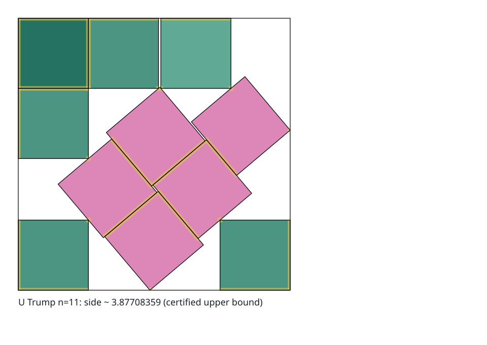

# Tutorial: Square Packing from First Principles

How small a square can hold eleven unit squares?
A $4\times4$ grid leaves five spaces empty.
Rotating some of the squares gives a packing with side about $3.87708$, and a matching
lower-bound proof establishes that no smaller square works.
Finding the arrangement and proving that it is best are different problems.

*Walter Trump’s 1979 construction: six squares are axis-aligned and five share an
oblique tilt of about 40.18°. Ahmed’s 2026 proof establishes its optimality; the
repository records the complete machine checks at `V3/C3` in
[T-060](packing/frontier/RESULTS.md).
The drawing shows the construction; the proof excludes every smaller container.
Segments mark shared edge intervals; dots mark point contacts.
They are computed in the exact number field and clipped to the participating squares.*

This basic tutorial develops the geometry and the distinctions needed to read a packing
result. The [advanced tutorial](TUTORIAL-ADVANCED.md) develops linear programming, exact
arithmetic, search, regularization, and computer-assisted proofs.
Result statuses below were checked against the repository’s register on 14 October 2026;
the [case records](packing/frontier/README.md) hold the maintained bounds.

## 1. The Problem

A **unit square** has side length one.
We place $n$ of them inside a larger square.
Each may translate and rotate independently.
They may touch along edges or at corners, but their **interiors must be disjoint**: no
positive-area overlap is allowed.
Every point of every small square must lie in the container, whose boundary is also
allowed to touch them.

The number $s(n)$ is the **smallest container side** that permits such a packing.
The minimum is attained: there is a best packing, even when we do not know it.
One way to see why is to take progressively smaller feasible containers and use the
bounded positions and angles to extract a convergent subsequence.
Containment and non-overlap survive the limit.
The compactness background is discussed in
[Martin’s work, listed with the mathematical references](TUTORIAL-ADVANCED.md#11-further-reading).

A **pose** specifies one square’s center and angle.
A **configuration** specifies the poses of all $n$ squares and the container side.
A **feasible configuration**, or packing, satisfies containment and non-overlap.
These definitions separate something a search program can propose from something that
has been checked to fit.

If the small squares had side $a$ instead of one, multiplying every coordinate by $a$
would multiply the answer by $a$. Fixing the small side at one removes that irrelevant
choice of scale.

## 2. Bounds and Small Examples

An **upper bound** $U$ means $s(n)\le U$: some packing fits at side $U$. A construction
proves such a bound once its geometry has been verified.
A **lower bound** $L$ means $s(n)\ge L$: every feasible container has side at least $L$.
It must account for arrangements we have never found, with every permitted rotation.
When a verified construction and a lower-bound proof meet at the same value, they prove
**global optimality**.

Two bounds require almost no geometry.

- **Area:** the small squares have total area $n$, so a container of area $s^2$ needs
  $s^2\ge n$. Therefore $s(n)\ge\sqrt n$.
- **Grid:** a square grid with $m=\lceil\sqrt n\rceil$ rows and columns has room for
  $m^2\ge n$ unit squares.
  Removing the unused ones gives $s(n)\le m$.

Thus

$$
\sqrt n\le s(n)\le\lceil\sqrt n\rceil.
$$

For $n=m^2$, the two sides agree: **$s(m^2)=m$**. For eleven squares they give only
$3.3166\ldots\le s(11)\le4$, leaving substantial room for better geometry.

| Number of squares | Optimal side | What the example teaches |
| --- | --- | --- |
| 1 | $1$ | One square fills its container |
| 2 or 3 | $2$ | Area alone need not give the answer; these classical lower bounds require geometry |
| 4 | $2$ | The area and grid bounds meet |
| 5 | $2+\sqrt2/2\approx2.70711$ | A tilted construction improves on the side-3 grid |
| 9 | $3$ | Another exact grid case |
| 10 | $3+\sqrt2/2\approx3.70711$ | A tilted construction improves on the side-4 grid |

The [three-square](packing/frontier/n-003.md), [five-square](packing/frontier/n-005.md),
and [ten-square](packing/frontier/n-010.md) records give the proofs and constructions.
Göbel supplied the five- and ten-square constructions; Stromquist supplied the
lower-bound proof for ten.
The decimal approximations in the table help compare sizes; the expressions with
$\sqrt2$ specify the exact values.

There is another useful comparison rule: **$s(n)\le s(n+1)$**. Removing a square from
any packing of $n+1$ produces a packing of $n$ at the same side.
Consequently a verified upper bound at a larger count may already imply a proposed upper
bound at a smaller one.
The register’s [T-156](packing/frontier/RESULTS.md) is an example: its bound for 290
squares follows from an existing certificate for 291.

## 3. Why Rotation and Contact Matter

Rotation changes how a square uses horizontal and vertical space.
An axis-aligned unit square spans one unit in each direction.
At $45^{\circ}$ it spans $\sqrt2$ in each, so rotating a square makes its bounding box
larger. The improvement comes from how several squares fit around one another, rather
than from a tilted square becoming smaller.

At eleven squares, restricting every orientation to $0^{\circ}$ or $45^{\circ}$ gives a
lower bound of $2+(4/3)\sqrt2\approx3.885618$, by Stromquist’s restricted-orientation
theorem. Trump’s packing fits below that side, at $3.8770835900\ldots$, so those two
orientation classes cannot contain an optimum.
Its five tilted squares use an angle near $40.18^{\circ}$ instead.
The [eleven-square case](packing/frontier/n-011.md) records the restricted theorem and
the unrestricted result separately.

A drawing can make two edges look touching when a tiny gap or overlap separates them.
A **contact** is an exact geometric equality: two square boundaries meet, or a square
meets a container wall.
For Trump’s exact construction, 14 of the 55 pairs touch.
Checking all contacts and all remaining separations is part of proving the construction
valid.

A **jammed backbone** is a contact-constrained subset that cannot move collectively in
the declared setting.
Other squares may still move without changing the side.
A **rattler** has room to move inside a cage formed by the other squares and the
container; a **slider** moves along a permitted family of positions.
Such motion does not disprove optimality, because the container need not become smaller.

For example, three axis-aligned unit squares with centers

$$
(1/2,1/2),\qquad(3/2,1/2),\qquad(t,3/2),\quad 1/2\le t\le3/2
$$

all fit in a side-2 container.
The top square can slide across the two bottom squares.
Every value of $t$ gives an optimal packing because $s(3)=2$. Changing coordinates
therefore need not discover a genuinely different optimal family.
The
[advanced tutorial](TUTORIAL-ADVANCED.md#2-refinement-corners-and-connected-families)
explains how relabeling squares, rotating or reflecting the container, and continuous
motion affect the objects a search should count.

**Rigidity**, **uniqueness**, and **optimality** ask different questions.
Rigidity rules out local motion in a declared setting.
Uniqueness says all optimal packings are the same after specified symmetries.
Optimality says none fits in a smaller container.
Each requires its own argument.

## 4. What a Computer Can Establish

A numerical search chooses centers and angles, measures overlaps or separation, and
adjusts the configuration to improve the container side.
It explores only some of the possible arrangements.
A run that finds nothing better supplies a search result, not a lower-bound proof.

Refinement improves a candidate near where it already lies.
A **local minimum** cannot be improved by a sufficiently small feasible change, while a
**global minimum** is best among all feasible configurations.
Even proving the first does not prove the second.
The advanced tutorial separates
[refinement from exploration](TUTORIAL-ADVANCED.md#2-refinement-corners-and-connected-families)
and explains how
[fixed-angle linear programs](TUTORIAL-ADVANCED.md#1-configuration-space-and-linear-programs)
make part of the search tractable.

### Numerical and exact coordinates

Floating-point numbers have finite precision.
A program may treat a tiny negative clearance as zero within a **tolerance**, a stated
allowance for numerical error.
That can help locate a promising packing, but an overlap smaller than the tolerance is
still an overlap. Printing a hundred digits does not establish that those digits
represent a valid construction.

An **exact certificate** instead specifies data and checks that decide the claim without
such an allowance. Rational coordinates use fractions of integers.
Algebraic coordinates can specify a root of a polynomial, distinguish it from the
polynomial’s other roots, and express the remaining coordinates in terms of that root.
Then a checker can decide whether a contact is exactly zero and whether every other
clearance has the correct sign.

**Rigorous interval arithmetic** offers another route: it encloses the true answer,
including rounding error.
If an entire clearance interval is positive, separation is proved.
An interval that straddles zero leaves that test unresolved; it does not prove a
contact. Certified equations can establish exact contacts, but ordinary approximate
residuals cannot.

There are accordingly two different uses of “exact”:

- An **exact construction** proves feasibility at its stated side, hence an upper bound.
- An **exact value of $s(n)$** also requires a lower-bound argument excluding every
  smaller side.

A rational construction may sit slightly above a suspected algebraic optimum.
Its certificate can be completely exact while its bound remains weaker than the optimum.

### What the status labels mean

The project records the statement being checked separately from the strength of its
evidence. For an individual evidence entry:

| Label | What has been established |
| --- | --- |
| `reported` | A named source states the claim |
| `numerically-checked` | A finite computation checked specified predicates at recorded precision and tolerance |
| `verified` | An exact check, rigorous certificate, or proof establishes the stated claim and its premises |

Whole results use two further scales.
**Verification (`V`)** describes the verification supported by the source packet;
**confirmation (`C`)** describes what a party beyond the producing run has established.
A source’s proof and this project’s replay are separate facts.
At `V3/C3`, the result has checkable support and the confirmation meets the
corresponding rung. Higher rungs require specified reviews and human oversight; formal
source code alone does not earn them.

**Significance (`S`)** rates importance, and **novelty (`N`)** records the supported
origin or novelty assessment.
An `S5` result can still be `V0/C1`: important enough to follow, but only reported and
read here. Neither significance nor a large number of printed digits proves the
mathematics. [Epistemics](epistemics.md) defines the complete scales and the evidence
each requires.

Even two passing checkers may share a parser, arithmetic library, or interpretation of
the claim. The record therefore states whether confirmation reproduced the producer’s
code, reimplemented it with shared components, or used an independent implementation,
and whether the check covered the whole claim or a sample.

## 5. Reading the Current Results

Eleven squares illustrate how the evidence fits together.
Trump’s exact construction proves an upper bound.
Ahmed’s proof supplies the matching lower bound, after a complete finite cover of
possible arrangements, exact exclusions, and a local argument around the surviving
configuration. The repository records the equality $s(11)=3.877083590022814\ldots$ as
**T-060, `V3/C3`**. Its checks share some arithmetic and construction components with
the source; this is documented confirmation, with its degree of independence stated.

Uniqueness is recorded separately as **T-112, `V3/C2`**: every optimum is Trump’s
packing up to container symmetry and relabeling.
Its additional equality-case argument has a different confirmation status from the
bound. A Lean formalization of the value has also been reported, but the complete build
and expert-review requirements for raising its formal-verification rung have not been
met in the retained record.
These distinctions are in the [results register](packing/frontier/RESULTS.md).

At seventeen squares the register keeps a different boundary.
Marc Leonard Overbeck’s candidate optimality proof (**T-153**) and Oscar Fitzharding’s
separate Lean formalization (**T-154**) both concern Bidwell’s side, approximately
$4.6755300936$. Both remain **`V0/C1`**, despite their `S5` significance.
Reviews and partial checks are retained, but the complete replays needed for
confirmation are outstanding.
The [seventeen-square case](packing/frontier/n-017.md) therefore distinguishes its
reported status from its verified status, which remains open.
Its verified bracket is

$$
4.66044275 < s(17)
\le \frac{23377650468022754758171074269267527}{5000000000000000000000000000000000}.
$$

The right side is about $4.675530093604551$. It is a verified rational upper bound; that
does not turn the reported equality into a confirmed one.

Many recent improvements concern larger constructions rather than optimality.
For example, Daniil Ostashev’s **T-158** supplies exact rational certificates for 175,
232, and 264 squares.
Each proves its stated upper bound.
None supplies a matching lower bound.
The [source packet](packing/resources/web/dostashev-records-2026-10-12/README.md)
credits the constructions and the earlier pieces they build on.

Two quantities help avoid misreading progress:

- The **bound gap** is the distance between the verified upper and lower bounds.
  It is zero at eleven and remains positive in the verified seventeen-square record.
- A **search gap** compares one run’s best side with a named standing best.
  A run can remain far from the optimum even after somebody else has proved its value.

A new report, an accepted intake review, and an adopted bound are also different steps.
The
[14 October intake ledger](packing/campaign/issue-intake/upper-bounds-20261014/README.md)
compares reported sides; it does not verify their certificates.
A tutorial or news item should not silently promote those reports into the case records.

## 6. Reading a Packing Picture

The atlas shows geometry alongside evidence and attribution.
A displayed square may come from a numerical source witness or from an exact
certificate. The accompanying record tells you which, what side was checked, and who
supplied the arrangement.
Pixels alone establish none of those facts.

A **regularized view** makes an existing arrangement easier to read: it may straighten
near-axis squares, close contacts, or align sub-blocks.
The source witness is retained.
Under the [regularization policy](docs/project/policies/regularization-policy.md), the
drawing keeps the source record’s evidence tier and credit; an exact redraw does not
silently upgrade either.
If the process produces a certificate below the case’s verified upper bound, that
certificate takes a separate result-registration path.
[The advanced tutorial](TUTORIAL-ADVANCED.md#4-certificates-regularization-and-evidence)
explains the checks and side comparisons.

A useful way to inspect any claimed improvement is to identify the exact statement:
which $n$, which side, and whether it concerns a construction, a lower bound, rigidity,
or global optimality.
Then follow its evidence link.
A claim about one packing is often much easier to establish than a claim about every
possible packing.

## 7. Further Reading

| To explore | Read |
| --- | --- |
| Linear programs, exact arithmetic, search and proofs | [Advanced Tutorial: Square Packing, Search, and Proof](TUTORIAL-ADVANCED.md) |
| Current bounds, sources and witnesses for each size | [The frontier](packing/frontier/README.md) |
| How historical record packings were found | [How Record Square Packings Are Found](https://jlevy.github.io/squares/papers/square-packing-methods-survey.html) |
| The complete eleven-square argument | [Eleven-Square Optimality](https://jlevy.github.io/squares/papers/n11-optimality-review.html) |
| Evidence grades, confirmation and credit | [Epistemics](epistemics.md) |
| The program, tools and retained research | [Synopsis](SYNOPSIS.md) and [development guide](development.md) |

## Advanced Topics and Earlier Links

The longer tutorial’s technical sections now live in the advanced companion.
These landings keep earlier section links usable without JavaScript.

| Earlier section | Current location |
| --- | --- |
| Contents | [Advanced tutorial](TUTORIAL-ADVANCED.md#1-configuration-space-and-linear-programs) |
| The state of $n = 11$, in one table | [Advanced tutorial](TUTORIAL-ADVANCED.md#the-state-of-n--11-in-one-table) |
| How a weighted atomic lower-bound proof works | [Advanced tutorial](TUTORIAL-ADVANCED.md#how-a-weighted-atomic-lower-bound-proof-works) |
| How the finite covering LP searches for atoms | [Advanced tutorial](TUTORIAL-ADVANCED.md#how-the-finite-covering-lp-searches-for-atoms) |
| Why condition on corner squares? | [Advanced tutorial](TUTORIAL-ADVANCED.md#why-condition-on-corner-squares) |
| 2. The Configuration Space | [Advanced tutorial](TUTORIAL-ADVANCED.md#1-configuration-space-and-linear-programs) |
| The cell decomposition | [Advanced tutorial](TUTORIAL-ADVANCED.md#the-cell-decomposition) |
| Thirty-four dimensions become one | [Advanced tutorial](TUTORIAL-ADVANCED.md#thirty-four-dimensions-become-one) |
| 3. Cells, Basins, and Two Traps | [Advanced tutorial](TUTORIAL-ADVANCED.md#2-refinement-corners-and-connected-families) |
| The quench map | [Advanced tutorial](TUTORIAL-ADVANCED.md#the-quench-map) |
| Trap 1—a fixed-angle cell solve is not a basin | [Advanced tutorial](TUTORIAL-ADVANCED.md#trap-1a-fixed-angle-cell-solve-is-not-a-basin) |
| Trap 2—a point-basin need not be a terminal component | [Advanced tutorial](TUTORIAL-ADVANCED.md#trap-2a-point-basin-need-not-be-a-terminal-component) |
| The generalized lesson, learned twice | [Advanced tutorial](TUTORIAL-ADVANCED.md#the-generalized-lesson-learned-twice) |
| 4. The Corner | [Advanced tutorial](TUTORIAL-ADVANCED.md#the-corner) |
| 5. Algebra Versus Numerics | [Advanced tutorial](TUTORIAL-ADVANCED.md#3-exact-arithmetic-and-reconstruction) |
| Why exactness is not optional | [Advanced tutorial](TUTORIAL-ADVANCED.md#why-exactness-is-not-optional) |
| The number field | [Advanced tutorial](TUTORIAL-ADVANCED.md#the-number-field) |
| How many roots does a packing need? | [Advanced tutorial](TUTORIAL-ADVANCED.md#how-many-roots-does-a-packing-need) |
| Assurance, method, and precision | [Advanced tutorial](TUTORIAL-ADVANCED.md#assurance-method-and-precision) |
| Contact graphs, stationary branches, and rattlers | [Advanced tutorial](TUTORIAL-ADVANCED.md#contact-graphs-stationary-branches-and-rattlers) |
| From a numeric solution to an exact one | [Advanced tutorial](TUTORIAL-ADVANCED.md#from-a-numeric-solution-to-an-exact-one) |
| 6. What Is Built, and What Is Not | [Advanced tutorial](TUTORIAL-ADVANCED.md#4-certificates-regularization-and-evidence) |
| 7. How the Search Is Approached, and Why | [Advanced tutorial](TUTORIAL-ADVANCED.md#5-search-design-and-its-limits) |
| The catalogue | [Advanced tutorial](TUTORIAL-ADVANCED.md#the-catalogue) |
| The strategy: why pointing should beat scaling | [Advanced tutorial](TUTORIAL-ADVANCED.md#the-strategy-why-pointing-should-beat-scaling) |
| Steering: keep the loss, change what you keep | [Advanced tutorial](TUTORIAL-ADVANCED.md#steering-keep-the-loss-change-what-you-keep) |
| Relaxation ladders: turn rare-event search into path-following | [Advanced tutorial](TUTORIAL-ADVANCED.md#relaxation-ladders-turn-rare-event-search-into-path-following) |
| Calibration must match mechanism, not just difficulty | [Advanced tutorial](TUTORIAL-ADVANCED.md#calibration-must-match-mechanism-not-just-difficulty) |
| Near-misses are the data | [Advanced tutorial](TUTORIAL-ADVANCED.md#near-misses-are-the-data) |
| 8. What Is Known, and What Is Not | [Advanced tutorial](TUTORIAL-ADVANCED.md#8-results-and-open-questions) |
| Established | [Advanced tutorial](TUTORIAL-ADVANCED.md#established) |
| Open | [Advanced tutorial](TUTORIAL-ADVANCED.md#open) |
| 9. How an Optimality Proof Is Built | [Advanced tutorial](TUTORIAL-ADVANCED.md#7-global-optimality-by-exclusion-and-capture) |
| Three parts | [Advanced tutorial](TUTORIAL-ADVANCED.md#three-parts) |
| The cap above the optimum | [Advanced tutorial](TUTORIAL-ADVANCED.md#the-cap-above-the-optimum) |
| The centre box and capacity-one covers | [Advanced tutorial](TUTORIAL-ADVANCED.md#the-centre-box-and-capacity-one-covers) |
| Symmetry and orbits | [Advanced tutorial](TUTORIAL-ADVANCED.md#symmetry-and-orbits) |
| Sub-pattern exclusion by containment | [Advanced tutorial](TUTORIAL-ADVANCED.md#sub-pattern-exclusion-by-containment) |
| Selection versus certification | [Advanced tutorial](TUTORIAL-ADVANCED.md#selection-versus-certification) |
| What makes a certificate admissible | [Advanced tutorial](TUTORIAL-ADVANCED.md#what-makes-a-certificate-admissible) |
| A local minimum modulo sliders | [Advanced tutorial](TUTORIAL-ADVANCED.md#a-local-minimum-modulo-sliders) |
| Capture | [Advanced tutorial](TUTORIAL-ADVANCED.md#capture) |
| Why exact arithmetic dominates the cost | [Advanced tutorial](TUTORIAL-ADVANCED.md#why-exact-arithmetic-dominates-the-cost) |
| 10. A Vocabulary Card | [Advanced tutorial](TUTORIAL-ADVANCED.md#9-vocabulary) |
| 11. A Notation Card | [Advanced tutorial](TUTORIAL-ADVANCED.md#10-notation) |
| 12. Further Reading | [Advanced tutorial](TUTORIAL-ADVANCED.md#11-further-reading) |
| What does the arithmetic here | [Advanced tutorial](TUTORIAL-ADVANCED.md#what-does-the-arithmetic-here) |
| 13. Where to Go Next | [Advanced tutorial](TUTORIAL-ADVANCED.md#12-research-and-implementation-guides) |

<!-- This document follows common-doc-guidelines.md.
See github.com/jlevy/practical-prose and review guidelines before editing.
-->
