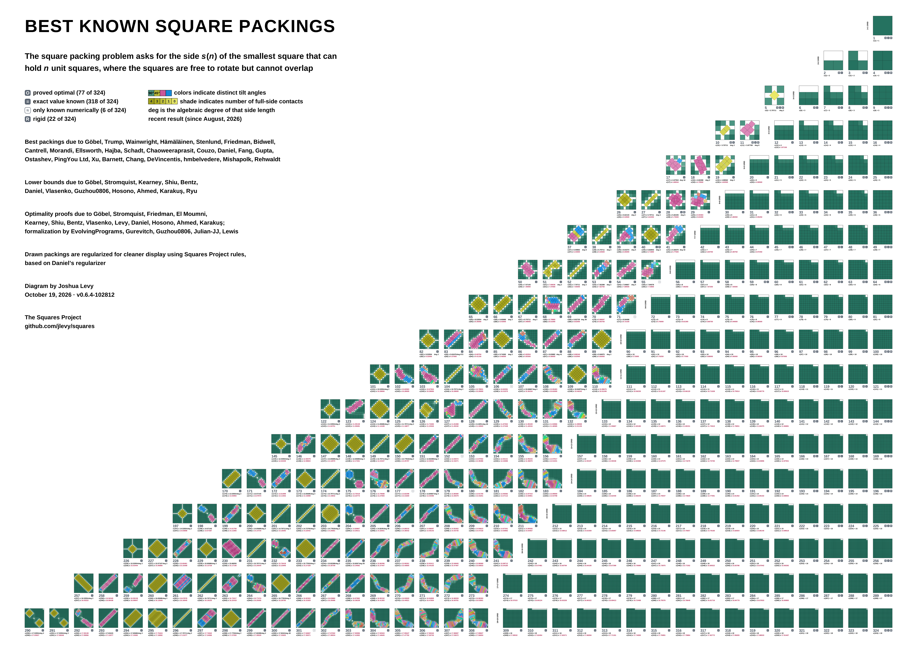

# Known-Best Packing Atlas, `n = 1..324`

This atlas retains one complete geometry record for every frontier case from $n = 1$
through $n = 324$ and renders every record with the repository’s deterministic house
renderer. The machine-readable discovery layer is [`manifest.json`](manifest.json).
The range widened from 100 on 2026-09-07 under
[the expansion plan](../../../docs/project/specs/active/plan-2026-09-07-atlas-expansion-to-324.md).
Two composites are drawn from it: the published figure of the first hundred, with its
10-by-10 layout, and a poster of the whole corpus beside it.
Each tile of both, like every drawing of a count on the site, shows the count’s default
picture: its [regularized view](#the-regularized-views) where that view improves on the
packing as published, and the house rendering of its witness everywhere else
([the default picture](#the-default-picture)). The calibration annotations further down
stay pinned to the first hundred by design.

The geometry records, drawings and exports in this directory are generated.
[`credit-attributions.json`](credit-attributions.json) is the curated input for
lower-bound and optimality-proof acknowledgments; it retains names, roles, source
references and evidenced dates without changing any scientific result.
[figure-playbook.md](figure-playbook.md) is the playbook for both: how to rebuild them,
where each fact on them comes from, what a third would take, and how the poster’s byte
budget was measured.

## The figure, `n = 1..100`

[](known-best-1-100.svg)

The composite is a native 10-by-10 SVG, not a screenshot montage.
Its 5,050 square polygons come from the same normalized witnesses as the individual
figures under [`rendering/`](rendering/) and the regularized views under
[`regularized/`](regularized/index.json).
The title and plain black “The Squares Project · github.com/jlevy/squares” line sit
above the grid; its problem description, legend, construction, lower-bound and
optimality-proof credits, regularization credits and dated diagram credit occupy a
footer.

Both composites share the same two-line problem description, two-column legend and
construction credits.
Each counted legend item names the count and number of cases in that composite, such as
“proved optimal (45 of 100)” or “proved optimal (77 of 324)”. Titles, problem
descriptions and all ordinary text use black; case numbers remain gray.
Changed numerical values and the angle/contact swatches keep their semantic colors.
A bundled bold sans-serif face supplies the print text and its layout measurements.
The gap between information blocks is three body-text ems, measured between their ink
bounds; the lines within a block share 1.50 leading and weight 700. All three credit
paragraphs use the width of the balanced three-line construction paragraph, with
complete names and role clauses kept together.
A fourth paragraph uses the owner’s approved two-line credit on both posters:

```text
Drawn packings are regularized for cleaner display using Squares Project rules,
based on Daniel’s regularizer
```

The paragraph’s SVG group retains the depicted regularized cases in
`data-regularized-cases` and the generators’ complete section 7 credits in
`data-generator-credits`. These structured values preserve the counts and attribution;
they are not printed in the compact credit.

The composite ships in four forms, all drawn from that one SVG in one build:

| File | Size | For |
| --- | --- | --- |
| [`known-best-1-100.svg`](known-best-1-100.svg) | 2150 × 3898 units | the source; scales to anything |
| [`known-best-1-100.png`](known-best-1-100.png) | 2150 × 3898 px | the GitHub-facing raster preview |
| [`known-best-1-100@2x.png`](known-best-1-100@2x.png) | 4300 × 7796 px | attaching, or downscaling for social media |
| [`square-packings-100-20261008.pdf`](square-packings-100-20261008.pdf) | 22.40 × 40.60 in | printing; vector, so text stays selectable |

Each export carries the SHA-256 of its source SVG, so `--check` rejects any one of them
that has fallen behind the drawing.
The 2x raster is scaled by a whole number rather than to a round pixel width: a
fractional scale lands every edge on a fractional pixel boundary, and the antialiasing
shades the rasteriser then invents cost more bytes than the extra pixels do.

## The poster, `n = 1..324`

[](known-best-1-324.svg)

Every case the register holds, at the figure’s card scale, arranged in a triangle: row
$k$ holds $n = (k-1)^2 + 1$ through $k^2$. All eighteen rows are complete and
right-aligned; the final row has thirty-five cards.
The packing drawings and card scale remain unchanged.
A $k×k$ grid label marks each row’s first retained regular axis-aligned grid packing;
the dimensions and `GRID` form one line rotated 90 degrees beside the grid segment, and
the card retains its ordinary count.
Its distance from the first grid outline matches the ordinary horizontal gap between
boxes. Where irregular packings precede it, an extra gap of half a drawing width (79
units) separates the groups horizontally.
Both PDFs use the same 287-unit row pitch and 203-unit column pitch.
Compared with the 214-unit column and 307-unit row pitches, visible horizontal box gaps
are about 20% tighter, and the annotation-to-next-row clearance is about 25% tighter.
Rows that are all grid receive no added horizontal gap.
The poster draws 52,650 square polygons from the same witnesses.
Its title, complete legend, explanation, construction credits and closing project
details form one block in the upper-left whitespace, leaving the bottom for the final
row of packings. Title and documentation are left-aligned; the legend has two
left-aligned columns, four status rows beside four recency, color and degree rows.
The last right-column item reads “deg is the algebraic degree of that side length,”
without a badge. The first two tilt-color swatches carry black $90^\circ$ and $45^\circ$
labels.
The information starts at the left edge of the first drawing in the final row; at
least 120 units of outside clearance keep the grid labels inside the page margins.
One dark $R$ means known rigid; its verification status, dates and sources remain in the
structured metadata.
The two-line definition uses 66-unit type; the following legend, credits and closing use
48-unit type in the shared bundled body font at weight 700. The definition and all body
lines use normalized leading 1.50, giving the 48-unit lines a uniform 72-unit baseline
pitch. The packing drawings and card captions keep their original scale.
The triangle’s bound captions use five decimal places, one fewer than the figure,
leaving room for the algebraic degree; a longer degree label can shorten the adjacent
side caption to four places.
Upper bounds round upward and lower bounds downward; stored bounds retain their full
precision. Three paragraphs credit best packings, lower bounds and optimality proofs.
Each uses complete canonical names once, ordered from oldest to newest by the earliest
supported result or contribution date.
Year-only dates retain their precision; ties follow alphabetical order.
Acquisition and snapshot dates do not establish priority.
The construction paragraph names all recorded finders and improvers.
The lower-bound paragraph names current bound-source authors; its metadata also retains
method, prerequisite and historical contributions.
The proof paragraph names mathematical proof authors, then everyone who worked on a
formalization or its verification infrastructure in one “formalization by” clause.
Both PDFs use the same acknowledgments for the full $n = 1..324$ corpus; their diagram
counts and depicted ranges remain specific to each figure.
Names wrap intact into balanced lines without bracketed citations or final periods.
Complete source citations, roles and case associations remain in the SVG metadata and
curated credit input.
A section gap separates the credits from the diagram credit, followed by the data date,
a middle dot and the generated edition stamp.
A blank line precedes exactly “The Squares Project” and “github.com/jlevy/squares”.
Both lines use the same 48-unit body font, weight and leading as the legend and credits.
They are plain black text without a hyperlink or PDF annotation, and start flush with
the information block’s left edge.
The black two-line definition appears above the legend: “The square packing problem asks
for the side $s(n)$ of the smallest square that can hold $n$ unit squares, where the
squares are free to rotate but cannot overlap”.
The first line ends after “can”.
The definition and credit paragraphs omit a final period.
Both composites apply the recent accent independently to a new upper bound, lower bound
or optimality proof: a new proof of an older packing colors its optimality badge, not
its upper bound.
The image above is the raster; the vector it was drawn from is one click
away, and the PDF is a 78.09-by-55.84-inch page.

| File | Size | For |
| --- | --- | --- |
| [`known-best-1-324.svg`](known-best-1-324.svg) | 7497 × 5361 units | the source; scales to anything |
| [`known-best-1-324.png`](known-best-1-324.png) | 7497 × 5361 px | the raster embedded above |
| [`square-packings-324-20261008.pdf`](square-packings-324-20261008.pdf) | 78.09 × 55.84 in | printing; vector, so text stays selectable |

The poster publishes one raster and a vector PDF. The rectangular poster’s 2x raster
measured 5,055,264 bytes for 83 megapixels; the poster publishes a single preview, while
the PDF preserves every square at any zoom.
The link-preview card is one page’s unfurl, which the figure above supplies.

The poster also draws a square more cheaply than the figure does, because ten times as
many of them will not fit in a file anyone should clone.
The poster drops the per-square `data-*` facts, states the stroke once per card instead
of once per polygon, and rounds coordinates to three decimals.
Measured on the rectangular poster, those choices reduced the house encoding’s 490 bytes
a square to 117.7. The triangle uses the same encoding.
All three departures are recorded in the drawing’s own metadata, the facts they drop are
still carried per case by [`rendering/`](rendering/) and
[`composite-figure.json`](composite-figure.json), and each was measured before it was
chosen:

```bash
uv run --frozen --all-extras --group dev python -m devtools.build_known_best_atlas --report
```

[The playbook](figure-playbook.md#the-two-composites) has the measurements and what each
one bought.

## The regularized views

The [regularization policy](../../../docs/project/policies/regularization-policy.md)
governs every view here: what admits a view, what goes to manual review, and what is a
register result instead.

[`regularized/`](regularized/index.json) holds the exact derived views the atlas draws,
one index entry a record under the contract `packing.squares:RegularizedAtlasIndex/v2`
([schema](regularized-atlas-index.schema.yaml)). Each entry names the generator that
decided it:

- **`regularize_axis_components/2`**, this project’s tool, run over every record by
  `python -m devtools.regularize_axis_components --update-atlas`. It straightens
  near-axis squares and slides axis-aligned ones into exact contact at the certified
  side.
- **Evan Daniel’s regularizer**, vendored under `vendor/evand-regularize/` and driven by
  `devtools.regularize_evand`, which brings each view to the record’s own side over the
  rationals where it can.
- **The grid-slack generator**, `devtools.regularize_grid_slack`, a port of his
  coincidence placement that starts from the witness’s exact frame and closes free grid
  slack.

A view from either of the last two enters only where the policy’s decision table admits
it (row 10), by `python -m devtools.regularize_evand layer --select admitted` (a
grid-slack run’s views by adding `--grid-run DIR --grid-counts N ...`, which draws that
run’s view at those counts in place of Evan Daniel’s), and only where it shares at least
as many full sides as the view it replaces.
The axis tool’s own record of that count stays beside it as `reference`. Such a view
carries the credit line *Regularized by the Squares Project with Evan Daniel’s
regularizer (evand/square-packing, MIT)*, in the index, in the view and in its drawing.
The [regularization process](../../../docs/project/guides/regularization-process.md)
gives the steps from a run to a merged view: generate, select with
`python -m devtools.regularize_select`, admit, render, record and validate.

On 13 October 2026 the index draws 90 views: 20 by the axis tool, 48 by Evan Daniel’s
regularizer (29 at the witness’s side and 19 at the verified upper bound) and 22 by the
grid-slack generator (2 by its version 0 and 20 by its version 1), with 181 records
unchanged and 53 refused.
At sixteen counts Evan Daniel’s views lay below the earlier ceilings and were held; they
were admitted once T-155 registered their exact sides and the runs were decided again
against the case records as they stand (`python -m devtools.regularize_evand reclassify
--refresh-bounds`); at 227 the grid-slack view is drawn instead.
At the 42 counts jlevy/squares#518 re-housed, both generators ran again on the new
witnesses. 14 of Evan Daniel’s views are drawn, each worse on no measure of the drawing
and better on at least one, and 10 grid-slack views where his regularizer admitted none
and the grid view draws better with nothing worse.
16 keep the axis tool’s view: 232’s grid view awaits review; at 236 his view turned two
squares 0.000537 degrees off their group and drew one more angle class; at 180 and 207
his views tied the axis tool’s on all seven measures at the same side, which the owner’s
rule of 13 October 2026 does not draw (“better on one or drawn at a smaller side”); the
three were withdrawn on 13 October; and at the rest neither generator draws better.
At 270 and 305, which jlevy/squares#553 re-housed again after those runs, the views
lapsed with the witnesses they were made from, and the axis tool’s views of the new
witnesses were drawn.
On 13 October 2026 the owner set what a drawn view must be: exactly verified at a side
no larger than the verified upper bound, and better or equal on the drawing, its pose
free to change
([the policy’s section 9](../../../docs/project/policies/regularization-policy.md#9-owner-decisions),
questions 13 to 15). Nineteen counts were drawn again under that rule.
At eight (87, 106, 152, 172, 182, 206, 268 and 301) the drawing sat above the bound, at
a decimal witness’s side, and Evan Daniel’s exact view at the bound is drawn instead.
At eleven a grid-slack view straightened at up to 1 or 5 degrees, or a new half-degree
view, draws better: 146, 176, 181, 199, 238, 239, 267, 270, 271, 305 and 306. Over the
nineteen, light / uneven / near-axis squares go from 78 / 232 / 113 to 39 / 117 / 1, and
house sides from 10,764 to 11,560; light squares under the house rule fall atlas-wide
from 5,455 to 5,381. Seven drawn views stay above the bound, each an exception question
13 names: at 18, 26, 66 and 85 Evan Daniel’s views sit about $10^{-30}$ above a
closed-form optimum (question 4), and at 110, 241 and 297 the drawing is at Francisco
Couzo’s decimal side, $3 \times 10^{-12}$ to $1.3 \times 10^{-11}$ above Evan Daniel’s
exact optimum, where the view at the bound draws fewer shared sides (110 and 241) or
awaits the owner’s review (297). `--check-atlas` and
`packing/tests/test_regularize_select.py` fail on a view above the bound at any other
count, both reading the one list, the axis tool’s `ABOVE_U`. Every drawn view carries
its regularization in the register’s terms (`by: project`, the method, the side and the
identity measured here), and `results.yaml`’s `regularized_drawings` records each one
whose packing a registered result holds, generated by
`python -m devtools.regularized_drawings`. The same tool writes a `regularization` note
into the case record of every drawn count: who regularized the drawing, with which of
this project’s modifications to Evan Daniel’s regularizer, at which side and of which
result’s packing, and that it is a pure regularization, which proves no new bound and is
not a result, or, at the fifteen counts where `T-155` registered the drawn
regularization’s exact side as an upper bound, that its side is registered as that
result
([the policy’s question 16](../../../docs/project/policies/regularization-policy.md#9-owner-decisions)).
Where the house is itself a regularization its source published, as at the thirteen
counts drawn from `T-146`’s certificates, the note credits the source first.
The 44 counts where `T-155` registered this project’s regularization but the layer draws
another view or none carry the note as well, crediting the Squares Project and naming
`T-155`. At 33 of `T-155`’s 59 counts, eight drawn and 25 not, its side is the side of
Evan Daniel’s earlier certificate (`T-101`), so the note says that `T-155` registers it,
that his certificate first certified it, naming `T-101`, and that it proves no new
bound. No view changes a side, a frontier value, an evidence tier or a credit, and none
replaces a witness. The modifications are read from each entry’s `run` and `method`: the
retry rungs the solve climbed (`run.rungs`), or before the retry ladder of 12 October
the one retry’s arguments (`run.retried_with`). The 23 vendored views admitted after the
ladder had no rungs recorded; on 13 October 2026
`python -m devtools.regularize_evand rungs` recorded them from their runs’ retained
reports at eight counts and, at the fifteen then drawn from the run on
jlevy/squares#518’s witnesses, from a fresh run of those counts,
`evand-regularize-adopt518-v2-rerun-2026-10-13` (917 s of wall, 2,097 CPU seconds at
three workers), whose views came out byte for byte the drawn ones.
Thirteen of the fifteen are drawn now, so 21 entries carry the rungs: Evan Daniel’s
views at 180 and 207 were withdrawn the same day, and their entries with them.
Each entry names the run that supplied its rungs as `run.rungs_from`, and the index’s
`runs` records the fresh run beside the runs whose views it draws.
A run’s receipt records no id, and the driver names a run by its directory,
`evand-regularize-<run directory>`; the fresh run’s directory was also `adopt518-v2`, so
that convention gives it the id of the 12 October run of 37 counts in
`runs/adopt518-v2`, whose reports `evand-regularize-refreshed-adopt518-v2` decided
again. Its id was therefore assigned afterwards, on 13 October 2026, by
`python -m devtools.regularize_evand rename-run`, and its block’s `id_note` says so.
The tool never writes over rungs or a retry an entry already records.
Only 152 climbed a rung (`force-kkt`); with 18’s earlier `dps-100`, those are the two
vendored views drawn with a retry, and none used a replica patch.
Exploration
[X-049](../../campaign/explorations/X-049-families-shading-and-the-large-n-limit.md#exact-regularization)
explains why the layer exists and what the axis tool changes.

### The default picture

On 13 October 2026 the owner made the regularized view the default picture, with the
house drawing kept as published
([the policy’s section 12](../../../docs/project/policies/regularization-policy.md#12-the-default-picture)).
A count’s tile on both composites, its atlas tile and frontier-survey thumbnail on the
site and the drawing that heads its case page are its regularized view where the view is
exactly verified on both routes, at a side no larger than the verified upper bound or
one of the exceptions question 13 names, and improves on the house drawing under the
policy’s
[improvement rule](../../../docs/project/policies/regularization-policy.md#11-the-improvement-rule):
worse on none of its goals and better on at least one, exactness included.
The case page keeps the house drawing one click away, under *As published*, with its
source’s credit; everywhere else the house drawing is the picture.

[`default-drawings.json`](default-drawings.json)
([schema](default-drawings.schema.yaml)), written by
`python -m devtools.default_drawings --update`, records each drawn view’s default, its
reason, and both drawings’ measures.
Its `totals` say how many views are defaults; its entries say which, and why each of the
others keeps the house: a view that replaces a numerically checked witness with an
exactly verified one may tie it on every measure, and a view that ties an exactly
verified house at its own side on every goal is no improvement, so the house stays its
picture and its case page says so.
The records-tier step `default pictures improve on their house drawings` measures every
view and its house drawing again on each pull request, fails on a stale record or a
regularized default the rule refuses, and lists the counts that keep the house; this
file states no count of its own, so it cannot fall behind the record.
It reads the exceptions above the bound from `devtools.default_drawings.ABOVE_U`, which
`packing/tests/test_regularize_select.py` holds to the layer.

`--check-atlas` runs in the records tier on every pull request: it holds the index to
the manifest, the witnesses and the views by digest, and reads each other generator’s
view against its entry (label, generator, credit, side and regularization).
It also holds every drawn view’s exact side to the witness’s own side $s_W$, which is
what `same` means, and to the case record’s verified upper bound $U$, decided exactly
for a closed-form $U$ as well: no view below $U$, a `bound` view exactly at it, and no
view above it at a count the tool’s `ABOVE_U` list does not name with its reason.
Seven views sit above $U$ at this layer, each a rounding above it and each an exception
question 13 names: four of Evan Daniel’s about $10^{-30}$ above a closed-form optimum,
and three at Francisco Couzo’s decimal side, $3 \times 10^{-12}$ to
$1.3 \times 10^{-11}$ above Evan Daniel’s exact optimum.
`--verify-atlas` is the deferred step `regularized atlas views re-derive exactly`, on a
`regularized-views` runner of its own in both the deep gate and the post-merge
checkpoint
([development.md](../../../development.md#the-deep-gate-the-deferred-surface-before-the-merge)):
it re-derives every axis-tool record, the references included, and decides each other
generator’s view again on both maintained exact routes, with its square count, its
identity against the witness and its shades measured again.

**The axis tool still refuses 71 Kingbird-derived records.** Their 36-digit poses
overlap by a rounding sliver at centre dilation 1, the only factor the tool uses; Evan
Daniel’s regularizer, re-solved at that promotion’s side, now draws three of them
($n = 18$, $66$ and $85$), and the rest stay refused here.
The index refuses one more record, $n = 51$, whose witness is exact over
$\mathbb{Q}(\sqrt{2})$, because the layer has no field arithmetic.
`promote_rational` would try wider ones: it scales every centre about the container’s
centre by $1 + 10^{-p}$, $p = 31, 29, \ldots, 3$, and keeps the first exact packing
within $10^{-9}$ of the printed side.
The tool’s `--smallest-dilation` flag runs that ladder.
On 2026-10-02 it was run over the 89 records refused at that time, and the census’s
`--witness` mode shaded each source and view.
The later SQUISH import replaces two of those source poses with exactly feasible
rational packings; the historical census below describes the earlier poses:

| Smallest verifying dilation | Records | Views below the register’s verified bound | Light green, house rule | Light green, stage rule |
| --- | ---: | ---: | --- | --- |
| $1 + 10^{-31}$ | 53 | 49 | 1,355 → 1,353 | 1,355 → 1,353 |
| $1 + 10^{-29}$ | 33 | 23 | 731 → 731 | 731 → 731 |
| $1 + 10^{-27}$ | 3 | 3 | 93 → 93 | 93 → 93 |
| All | 89 | 75 | 2,179 → 2,177 | 2,179 → 2,177 |

Every view passed both exact verifiers, and none made a square lighter or needed a hold.
The views still fail the claim boundary, for two reasons:

- **Most would promote a tier.** On 2026-10-02, for 73 of the 89 the register’s verified
  upper bound was the grid ceiling, because the Kingbird catalogue was reported evidence
  that had never been replayed.
  An exactly verified view there was a rational packing 0.05 to 0.46 below that bound,
  and a drawing would have carried a certificate the register did not.
  At $n = 17$ and $n = 29$ the view lay $10^{-22}$ and $5 \times 10^{-20}$ below the
  certified endpoint the register held, which is the same promotion at smaller scale.
  The grid-ceiling count no longer holds: T-101 (registered 2026-10-06) made Evan
  Daniel’s exact certificates the verified upper bound at 74 Kingbird counts, and on 11
  October none of the 74 records the layer then refused had the grid ceiling as its
  verified bound. The 72 it refuses now are among those 74
  ([the assessment, section 3.2](../../../docs/project/research/research-2026-10-11-evand-regularization-assessment.md#32-the-side-relation-same-or-solved)).
- **The rest would change the side.** For the other 14 the register already verifies the
  reported bound, but a dilated view’s container is $2.9 \times 10^{-31}$ to
  $8.8 \times 10^{-29}$ larger than the printed side and lies above the verified bound,
  and every centre has moved.
  That is not the author’s packing at the certified side.

What it would buy is two squares.
The views’ remaining light faces are structural: 3,873 face a tilted neighbour, 132 face
a hole, and 129 face an offset row, with no slack.
Only one square at $n = 85$ and one at $n = 227$ compact, by 0.37 and 0.29. Every other
move snaps shut a gap the dilation itself opened.
The flag stays in the tool as the instrument that measured this.
A view framed by it is a scratch artifact and never part of the layer.

## What the drawings are drawn from

The pipeline has four separate layers:

1. exact canonical grids, attributed Kingbird-derived numerical facts, source packets’
   derived facts, or retained UnitSquare SVG renderings;
2. normalized [`Witness/v2`](../../witnesses/witness.schema.yaml) geometry;
3. numerical or exact feasibility receipts at the assurance the source supports; and
4. deterministic SVGs under [`rendering/`](rendering/).

Chunk decompositions do not belong in the source witness.
They live in separate, regenerable annotation artifacts with their detector version,
deterministic objective, tolerances, and limitations.
The current annotations are explicitly calibration-only because the 1–100 corpus was
inspected during their design.
This prevents a taxonomy invented from the corpus from being counted as independent
confirmation on the same corpus.

[`chunk-components.json`](chunk-components.json) is the exploratory layer that tests the
assembly intuition without crossing that boundary.
At the registered `1e-6`-radian angle and `1e-3` contact tolerances, 1,782 of 1,860
squares in the 36 non-grid records belong to a multi-square same-angle contact
component.
Twenty-five of those 36 records use no more than six such components and three
singletons. This is strong evidence for a broad **contact-assembly** description.
It is not yet evidence that every component is one of the enumerator’s narrower bar, L,
or rectangle skeletons.

The 36 non-grid records contain 169 multi-square components: 55 contact chains and 114
cyclic patches. Contact-normal equalities alone leave 859 internal slide degrees before
overlap intervals or wall contacts are applied, and 792 squares are wall-seated at the
registered contact tolerance.
A connected contact assembly is therefore not automatically a rigid chunk; the next
grammar must retain and price those slides.

The retained maximal-lattice detector establishes that stricter decomposition directly
for only 21 of 100 records.
Its other 79 results are recorded as `not-established`, not as failures: a maximal
polyomino may split into two allowed chunks.

[`chunk-partitions.json`](chunk-partitions.json) performs that split with a bounded,
deterministic exact-cover search over contiguous bars, filled rectangles, and corner Ls.
It certifies all 64 grid-derived records and 3 of 36 non-grid records inside the
six-chunk/two-free budget.
Two non-grid cases are conclusively outside that budget, 23 have no partition in this
candidate universe, and eight are search-capped and therefore indeterminate after the
declared 10,000-state limit.
The broad contact result and the narrow partition result therefore point in the same
direction: same-angle assembly is common, but rigid integer-lattice chunks are too
narrow as the only grammar for the interesting records.

The partition atlas evaluates every allowed exact free-square count, prefers an
in-budget certificate when one exists, then minimizes free squares before chunk count.
If an earlier free-count slice is capped, a later in-budget certificate still proves
existence, but the retained selection marks its free-square and chunk minimality as
indeterminate. A later out-of-budget certificate leaves both budget membership and
`F`/`C` minimality indeterminate; likewise, any later capped slice leaves an earlier
out-of-budget certificate indeterminate.
The atlas reports exact and near bands separately and types state-cap and
candidate-universe limitations.
It is calibration evidence only and emits no H-044 verdict.
The contrast is useful rather than embarrassing.
It says the corpus supports the chunk intuition while the current grammar and detector
do not yet support the proposed coverage claim.

[`chunk-evidence-profile.json`](chunk-evidence-profile.json) condenses the full non-grid
census into 36 source-stratified rows.
Its [`house-rendered overview`](evidence/non-grid-chunk-evidence-profile.svg) shows
contact coverage, component count, free squares, largest component, internal slide
degrees, the narrow partition disposition, and the broad-budget flag for every case.
Ten cases are fully covered, 27 cover at least 90 percent, 33 cover at least 75 percent,
and 35 cover at least half; $n = 5$ is the lone zero-contact outlier.
Orange row outlines identify the only registered-to-regularized changes ($n = 68$, $69$,
and $71$) instead of hiding tolerance sensitivity in an aggregate.

[`contact-assembly-grammar.yaml`](contact-assembly-grammar.yaml) records the proposed
revision as a versioned, schema-checked draft.
It keeps rigid lattice chunks as a strict subgrammar and adds contact scaffolds whose
tangential slides remain LP variables.
Its complexity tuple charges free squares, assemblies, internal slide degrees, angle
classes, mandatory contacts, and largest assembly size.
No scalar budget is frozen yet.

[`contact-enumeration-pricing.json`](contact-enumeration-pricing.json) prices the first
target-free implementation without reading atlas geometry.
Exact connected labeled counts grow from 15,104 at size 4 to 9,684,224 at size 5. The
exhaustive size-4 control reduces to 124 canonical labels and local LP solves; 26 pass
the local equations, which accept one fitted-angle class only and still omit walls,
non-edge separation, and container fit.
Mixed angle classes fail before an LP solve.
The isomorph-free size-5 path reduces 1,533,696 topology colorings to 11,013 exact
orbits. Those abstract representatives are retained without geometry or local LP
outcomes; the earlier 9,296,855,040-image raw path remains only a differential oracle.

[`contact-full-cell-control.json`](contact-full-cell-control.json) is a separate
literal, source-free structural control for CG-010. Its three-square axis-aligned L has
eight available non-edge axis-and-order branches; the retained fixture selects one raw
cell, checks all 48 D4-by-relabeling images, emits one canonical label, and performs
zero LP solves. The artifact validates representation, canonicalization, typed caps, and
work accounting only.
It contains no centres, side, geometry, container-fit result, packing feasibility claim,
or optimality claim.

[`contact-overlays.json`](contact-overlays.json) indexes five deterministic visual
strata from the registered descriptive census: $n = 11$, $28$, $40$, $68$, and $89$.
Every SVG under [`contact-overlays/`](contact-overlays/) uses the same house renderer as
the base atlas. Dashed orange lines join square centres or a centre to a seated wall;
they show tolerance-qualified graph incidence, not exact physical contact loci or
rigidity. The numerical overlay feature is deliberately distinct from the renderer’s
certified exact-contact feature, and the gallery remains calibration-only.

## Coverage Policy

Exact integer records use a canonical row-major subset of the corresponding grid.
Noninteger catalogue records use attributed Kingbird-derived numerical center and angle
facts retained in Witness/v2; the upstream SVGs are not retained in this source
inventory because the review located no express redistribution terms.
This is a conservative retention policy, not a legal conclusion.
The newer public UnitSquare renderings superseded the older Kingbird geometry at
$n = 68, 69, 103, 105, 110$ and $131$; their six-decimal polygon coordinates are
explicitly recorded as rendering-derived numerical evidence, not as the unavailable
interval boxes named in their metadata.
None draws one now: Couzo’s packings supersede five of them, and $n = 69$ moved on
2026-10-05 to the catalogue’s later side for the same packing, David Ellsworth’s
optimization (T-088).

At $n = 69, 83$ and $87$ the catalogue facts are not read from the SVG itself, which the
session that took in their September 2026 sides could not fetch, but from Evan Daniel’s
binary64 parse of it, pinned at a commit of `evand/square-packing`; each witness names
that file in `source.revision` and says so in its limitations.
`devtools.derive_kingbird_facts --compare-parse` measures that parse against this
repository’s own: at the 90 counts whose witnesses were read from their own pictures,
every side agrees and every pose agrees to one binary64 ulp.
Before the three were taken in it also compared $n = 83$ and $87$, whose retained
witnesses still described the pictures the catalogue had replaced, and those two were
the only ones that differed.

At 50 counts the drawing is a parallel project’s packing, read from its source packet’s
derived facts: Francisco Couzo’s at 49 counts from $n = 68$ to $307$ (T-056), seven of
them, $n = 208, 209, 228, 263, 272, 303$ and $306$, from his revision of 3 October 2026
(T-092), and Joost de Winter’s at $n = 211$ (T-057), the first drawing of 211 squares
that is not the grid.
Neither source publishes a licence, so the packets keep the centres and angles and the
upstream digests, never the files, as for Kingbird.
Each of these packings is also certified exactly here, which the case record carries in
its verified lane; the atlas witness itself stays the numerical one.

Every witness limits its claim to feasibility of the retained construction.
The phrase “known best” comes from the frontier register and never turns a numerical
witness into an optimality proof.

## Rebuild

From `packing`:

```bash
uv run --frozen --all-extras --group dev python -m devtools.build_known_best_atlas --check
uv run --frozen --all-extras --group dev python -m devtools.census_known_best_chunks --check
uv run --frozen python -m devtools.render_known_best_contact_overlays --check
uv run --frozen python -m devtools.profile_known_best_chunks --check
uv run --frozen python -m devtools.price_contact_enumeration --check
```

Source acquisition is an explicit network operation and is not part of CI:

```bash
uv run --frozen --all-extras --group dev python -m devtools.build_known_best_atlas --fetch
uv run --frozen --all-extras --group dev python -m devtools.build_known_best_atlas --update
```

The first command acquires only missing UnitSquare assets unless `--refresh` is
requested; Kingbird live audits are ephemeral and write no geometry.
The second rebuilds witnesses, individual house renderings, the manifest, and frontier
witness links from retained inputs.
For a layout change, `--update-composite-records` refreshes only the composite geometry
in the manifest and figure record, refusing changes to case facts or legend totals.
Commit those data records and re-pin the release before redrawing the composites.
The two composites and their exports are drawn apart, by `--update-composites`, at a
version bump or on demand; each states the data commit it was drawn from, and
`--check-composites` holds it to that statement without rebuilding anything
([the figure playbook](figure-playbook.md#rebuild-it)). `--report` measures what those
exports cost — bytes, square polygons, bytes per square, and how each composite encodes
a square — without rebuilding anything.
Rasters are drawn by cairosvg, the same renderer that draws the PDFs, so every export of
one drawing agrees; check mode reads the embedded source-SVG receipt without invoking a
renderer at all. Git remains the integrity boundary for co-committed outputs.
Upstream asset integrity uses only hashes declared independently by a source; the PNG’s
local source-SVG receipt tracks derivation and is not source evidence.

<!-- This document follows common-doc-guidelines.md.
See github.com/jlevy/practical-prose and review guidelines before editing.
-->
