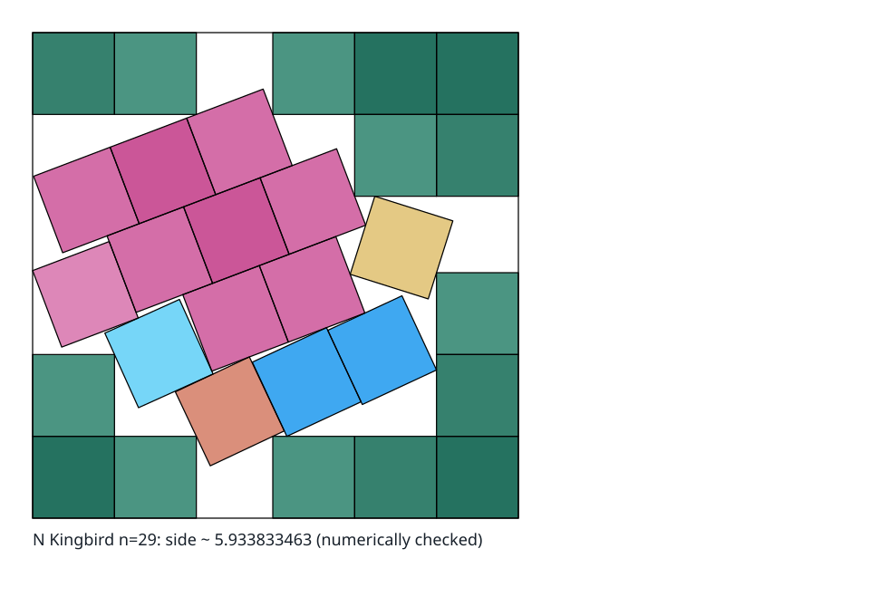

# `s(29)` — open

**Exact regularized certificate, 2026-10-12.** This project’s regularization pass, Evan
Daniel’s exact solver and regularizer run here on this register’s witness, produced an
exact rational packing of this arrangement, decided here over $\mathbb{Q}$ by two exact
checkers: it proves $s(29) \le 5.93383346267692918968946061635201914$, the verified
upper bound (T-155), which the record still prints as $5.93383346267692918974379895098$.
Until then the verified upper bound was exactly $5.93383346267692918974379895098$, the
upper endpoint of this project’s interval certificate of the same packing (T-009).

**External intake, 2026-10-06.** wand125’s
[mixed-certificate source](../resources/web/wand125-mixed-bounds-check2-2026-10-06/README.md)
reports $s(29) \ge 581/100 = 5.81$ (T-108), from a density of 505 rectangles of total
mass $2899999/100000 < 29$, on a net the certificate declares: core side $999/1000$ and
416 half-angle tangents of step $1/1001$. Since $999/1000 \cdot (1 + 1/1001) < 1$, every
unit square contains a core at a net angle strictly in its interior.
The source accepts it at every net angle by its research copy of Tokoharu’s checker at
threshold one.
It is above the reported $2319/400$ (T-068) by $0.0125$. This repository’s
clean-room verifier `sqverify-fast` decided it here on 6 October 2026 at all 416
directions of its net, and refused two mutants scaled below coverage one: confirmed,
independently re-implemented, so it is also the verified lower bound.
wand125’s README says parts of the work were produced with AI assistance under human
direction.

**External intake, 2026-10-01.** wand125’s
[rectangle-density source](../resources/web/wand125-rectangle-certificates-2026-10-01/README.md)
reports `s(29) >= 2319/400 = 5.7975`, since superseded (T-108), with total mass
$2899/100 = 28.99 < 29$, accepted by Tokoharu’s unchanged interval checker.
The complete 201-direction coverage replay here accepted it again, after this
repository’s exact audit checked that the regenerated checker input is the published one
and checked the mass and net premises, so it was also verified until 2026-10-06, when
the certificate above superseded it in both lanes.
wand125’s README says parts of the work were produced with AI assistance under human
direction.

**External intake, 2026-09-28.** wand125’s
[rectangle-density source](../resources/web/wand125-rectangle-certificates-2026-09-28/README.md)
reports a direct $579/100 = 5.79$ certificate for this case, whose reported bound the
2026-10-01 intake above raises, with total mass $2899/100 = 28.99 < 29$, accepted by
Tokoharu’s unchanged interval checker.
This repository’s exact audit checks that the regenerated checker input is the published
one, and checks the mass and net premises; the complete coverage replay has not yet run
here, so the verified lower bound is unchanged.
wand125’s README says parts of the work were produced with AI assistance under human
direction.

**External intake, 2026-09-27.** wand125’s
[rectangle-density source](../resources/web/wand125-rectangle-certificates-2026-09-27/README.md)
reports a direct $1157/200 = 5.785$ certificate for this case, whose reported bound the
2026-09-28 intake above raises, with total mass $2899/100 = 28.99 < 29$, accepted by
Tokoharu’s unchanged interval checker.
This repository’s exact audit checks that the regenerated checker input is the published
one, and checks the mass and net premises; the complete coverage replay has not yet run
here, so the verified lower bound is unchanged.

The
[Tokoharu density source](../resources/web/external-square-certificates-2026-09-22/README.md),
retained on 2026-09-22, reports `s(29) >= 571/100 = 5.71`, which superseded wand125’s
$557/100 = 5.57$ point certificate and was the verified lower bound until 2026-10-02.
The
[mathematical audit](../../docs/project/reviews/review-2026-09-22-tokoharu-density-mathematics.md)
records the complete local interval replay and exact premise checks.
That evidence verifies the retained fixed certificate at $571/100$. Tokoharu’s README
says parts of the work were produced with AI assistance under human direction.

Open. The best reported packing gives $s(29) \le 5.93383347$, and this repository’s own
interval certificate verified $s(29) \le 5.93383346267692918974379895098$ until 12
October 2026, and its exact regularized certificate now verifies
$s(29) \le 5.93383346267692918968946061635201914$, while wand125’s mixed certificate on
a declared net proves $s(29) \ge 581/100 = 5.81$ (`T-108`, 2026-10-06, `V3/C3`), which
superseded its rectangle-density certificate of 1 October at $2319/400 = 5.7975$
(`T-074`, replayed here on 2026-10-02), that one its replayed $579/100$ (`T-070`), and
that one Tokoharu’s $571/100$. The verified interval has width about $0.1238$. The
verified upper value is not the reported one: it sits above it by
`9.18974379895098E-15`, which is what proving the construction costs against reporting
it.
An earlier reading of this paragraph named $5.93388579981302587863645209$, the weaker
verified ceiling this case held before `T-009`, and it outlived that result (`D-442`).

## The verified upper bound is a ceiling

`verified_upper_bound` for this case is $5.93383346267692918968946061635201914$,
exactly, proved by the exact regularized certificate of this packing
(`E-regularized-bounds-2026-10-12-exact-decision`, T-155), and the record prints it as
$5.93383346267692918974379895098$. As printed it is **larger** than the best known
$5.93383346267692$ two fields above it, by `9.18974379895098e-15`.

It is not the value of $s(29)$ and not a different packing: it is the certificate’s own
exact side. It lies `9.2e-15` above the side the catalogue prints, more than half a unit
of the printed side’s last place, so the two disagree at the printed precision and the
printed side itself is not certified here.
The `mathematics` blocker in the frontmatter records the difference.
Read `reported_upper_bound` for the best known side length.

Until 12 October 2026 that printed decimal was the bound exactly, the upper endpoint of
this project’s interval certificate (`E-n029-interval-certified-upper`, T-009) at a
declared relaxation of `1e-20`, which on 30 August 2026 had replaced an exact rational
replay at $5.93388579981302587863645209$.

## The regularized exact certificate

This project’s regularization pass of 11 and 12 October 2026 ran Evan Daniel’s exact
solver and regularizer
([`evand/square-packing`](https://github.com/evand/square-packing), MIT, vendored here)
on this register’s witness for this count, with the `conservative` angle policy and
`coincide` placement, and this project’s same-side re-solve then fixed the result’s
tight contacts over $\mathbb{Q}$ at the witness’s own side.
The result is an exact rational packing of the same 29 squares in a square of side
$5.93383346267692918968946061635201914$, `5.4e-20` below the endpoint of the interval
certificate. Measured against the witness under the box’s eight symmetries, its squares
pair one to one with the witness’s; 3 move by more than `1e-3`, the largest by `1.3e-2`,
and none turns by more than `1e-6` as a sine.
It redraws the packing visibly, and is drawn only once the regularized layer admits it
under the regularization policy.

Each pair and each wall is decided over $\mathbb{Q}$ twice, by `sqpack`’s exact
separating-axis test and by an independent checker that shares no code with it, and both
accept it; both refuse it with its tightest pair pushed into overlap and with its box
shrunk past its least clearance ([certificate](../cases/regularized_bounds/README.md)).
The same two checkers accepted it in the run that made it, so this is a reproduction
with the producer’s code.
That proves $s(29) \le 5.93383346267692918968946061635201914$, the verified upper bound
(T-155), the exact form of the case’s `verified_upper_bound`, which prints it as
$5.93383346267692918974379895098$, the decimal it printed before and an upper display of
it. It says nothing about optimality, and the packing stays its finders’.

## The packing

Found by Thomas Schadt in 2025 via simulated annealing, then improved by David Ellsworth
with the analytic six-equation construction retained in the primary SVG.



*The document-ready view evaluates the retained roughly 100-digit numerical source at
160 decimal digits of working precision and tolerance `1e-80`.*

## The analytic characterization

This case has no minimal polynomial anywhere — in the literature or here — which is why
`exact_form`, `algebraic_degree` and `minimal_polynomial` are all null.
It does not follow that nothing exact is known.
The retained SVG publishes a **complete closed system**, and that system *is* the
characterization: nine slide scalars `r1, r2, r3, r4, r5, r8, rB, rC, rD`, each given in
closed form, and six equations `f1 … f6` in the six unknowns
$\lbrace s, a, b, c, d, i\rbrace$. $s(29)$'s reported value is the root of that system
near $5.9339$.

The six unknowns are $s$ together with the five tilted orientation classes; the sixth
class is the axis class, which holds fifteen squares at zero degrees.
[`cases.kingbird29.verify_svg`](../cases/kingbird29/verify_svg.py) transcribes every
scalar and every equation, and uses them to check residuals at the serialized pose.

Solving that same transcription, rather than only evaluating it, was done on 2026-08-28
as a design-discussion measurement — recorded in
[X-004](../campaign/explorations/X-004-n29-exact-promotion.md), which spends no
experiment budget and asserts no verdict.
It is **not yet an in-repository capability**: `verify_svg` still only evaluates.
Turning it into one is
[agenda-005](../campaign/agendas/agenda-005-symbolic-promotion-and-identity.md)’s
BC-047, whose entry condition names this transcription and which is `ready` for that
reason. The measurement:

| Quantity | Value |
| --- | ---: |
| $s$ at 60 digits | $5.93383346267692918968946061635201913843383418107788697463883$ |
| Agreement with the reported $5.93383346267692$ | all 15 published digits |
| Maximum equation residual at 420 digits | `8.85e-421` |
| Maximum equation residual at 1200 digits | `1.11e-1200` |
| Wall-clock for a 420-digit solve | about 2 seconds |

The solved angles agree with the orientation classes below — which are derived
independently, from the parsed `<use>` transforms rather than from the equations — to
every digit compared.
Two separate readings of the same source therefore agree.

**This does not move any bound.** A high-precision root is not a certificate: no
outward-rounded interval and no exact algebraic form is produced, so
`verified_upper_bound` remains the Schadt rational and the `5.23e-5` gap to the reported
record stands. What the solve does establish is that precision at this $n$ is available
to any depth on demand, which is a precondition for an exact promotion rather than the
promotion itself. See [X-004](../campaign/explorations/X-004-n29-exact-promotion.md).

## Six Numerically Checked Orientation Classes

[Exp-012](../campaign/series/series-000-smoke-and-calibration/experiments/exp-012-h-024-n29-angle-classes.md)
first reconstructed all 29 squares from the retained SVG, checked all 406 pairs
numerically at 160 decimal digits and tolerance `1e-80`, and replayed the source’s nine
derived offsets and six defining equations.
The orientations are $0^\circ$, $25.258655^\circ$, $20.800127^\circ$,
$-17.506268^\circ$, $24.962588^\circ$, and $24.308358^\circ$ modulo quarter turns.
[Exp-037](../campaign/series/series-000-smoke-and-calibration/experiments/exp-037-h-042-n29-numerical-angle-classes.md)
repeats that check under H-042’s explicitly numerical criterion and rejects its
three-class bound.
H-024 remains formally unresolved because the SVG supplies no exact or
rigorous feasibility certificate.

The check is deliberately described as high-precision numerical reconstruction.
The SVG serializes a `FindRoot` solution rather than supplying an interval or symbolic
certificate, so this does not independently certify exactness or optimality of the
record value.

## What the Schadt repository establishes

Thomas Schadt’s 2025 repository reports the earlier `5.933885799813025878636452...`
construction as valid at 300 decimal digits with tolerance `1e-100`. Replaying its
complete 29-square input through the generic witness tool reproduces that numerical
acceptance. It also exposes why this is not formal: 13 pairs have slightly negative best
separation, with the worst about `-8.81e-102`, inside the checker’s tolerance.
The source checker also accepts an incomplete file, so its output alone does not
establish the quantified 29-square claim.

The generic promotion command, run at its default `--rational-digits 36`, rationalizes
the orientations, adds an explicit side relaxation of about `4.93e-31`, and writes a
complete rational-corner witness.
A separate exact checker, sharing no geometry code with the promoter, verifies all 29
unit squares, all 406 pairs, and the container constraints.
This proves the formal upper bound shown above.
It remains weaker than the newer Kingbird report, and neither construction says anything
about global optimality.

## The lower bound

The superseded external report, [Friedman DS7], gives the lower-bound expression
`6*sqrt(5)/5 + 2*sqrt(2)` for $s(29)$ (approximately $5.511708697746$). Friedman’s DS7
survey, Theorem 10, k=5, reports this bound at n=28; reference [8] is Green’s private
communication (2000). The source proof has not been recovered.
Inherited at n=29 by monotonicity.
Tokoharu’s $571/100$ later owned the reported source field and was the verified lower
bound, after the complete interval replay and exact premise checks, until wand125’s
replayed rectangle-density certificate superseded it on 2026-10-02. The historical
[source audit](../devtools/audit_ds7_lower_bounds.py) compares Green’s exact theorem
expression separately from opaque table decimals.

The replay uses the retained source coverage implementation.
A method-distinct coverage implementation would add confidence and improve native
support for future rectangle-density certificates, but it is not a missing premise of
this fixed bound.

**Corrected 2 October 2026:** Nagamochi’s Lemma 1 is false (Karakuş 2026), so his closed
form below is now a reported bound whose published proof is incomplete
([review](../../docs/project/reviews/review-2026-10-02-nagamochi-lemma1-karakus.md)).
This register had recorded that proof as verified, its own error, logged as defect
[D-516](../../defects.md).
Nagamochi’s earlier general closed form remains part of the evidence history and applies
to every $N \ge 4$:

```
s(N) ≥ min{ ⌈√N⌉,  √(N − 2⌊√N⌋ + 1) + 1 }
```

<!-- BEGIN verification code: written by devtools.render_case_verifiers -->

## Verification Code

The programs behind this case’s verified bounds, by their evidence.
The code column says how the code that ran stands to the code its producer used.
[`VERIFIERS.md`](VERIFIERS.md) says what each program is and whose it is.

| bound | evidence | run | code | programs |
| --- | --- | --- | --- | --- |
| verified lower | `E-n029-wand125-mixed-581-sqverify-fast-replay` | replayed here | independent | `V-sqverify-fast` (first-party) |
| verified upper | `E-regularized-bounds-2026-10-12-exact-decision` | replayed here | producer’s code | `V-sqpack-verify`, `V-check-rational-witness-independent` (first-party); `V-register-regularized-bounds` (first-party, premises) |

<!-- END verification code -->

<!-- This document follows common-doc-guidelines.md.
See github.com/jlevy/practical-prose and review guidelines before editing.
-->
